# laya_rag

A retrieval-augmented generation system that uses [Laya](https://github.com/thread3d/laya) as its
retrieval and decision engine, with a command line, an HTTP API and a web interface.

**Version 1.1.1** — the first tagged release; see [`CHANGELOG.md`](CHANGELOG.md) for what it contains and
what it deliberately does not claim.

Clients meet the engine over a local HTTP service:

![Architecture: browser, HTTP and MCP clients, and the CLI reach the local Python engine through its three interfaces — an HTTP API on port 8077, an MCP server over stdio or HTTP, and the command line. The engine chunks, embeds and indexes (delete-by-id tombstones, compact reclaims), recalls with dense + BM25 screened by the trust/ACL predicate before fusion and reports the pool's shape, re-ranks and gates answerability with Laya (an optional feature gate, with the bridge-conditioned column opt-in), and returns an evidence bundle with calibrated probabilities, from which an extractive composer emits verbatim spans. Every index mutation is written to a hash-chained audit log. It loads a Laya torch checkpoint, and the caller composes the answer, or not.](docs/architecture.png)

## Why the split is shaped this way

Laya is not a generative model. It is a **non-autoregressive decision engine**: it evaluates typed
questions (`choice`, `score`, `noul`) over a body of text in a single forward pass and returns
calibrated probabilities. Its README is explicit — *"No text generation, so nothing to parse and
nothing to hallucinate."* It also ships no document loader, no chunker and no vector store.

That determines the architecture:

| Concern | Owner | Why |
| --- | --- | --- |
| Chunking, persistence, retrieval | this project | Laya ships none of it |
| Embeddings | **Laya** | `embed_fn_from_agent` mean-pools the checkpoint encoder |
| Relevance re-ranking | **Laya** | calibrated `noul` decision, thresholdable |
| Answerability gating | **Laya** | calibrated `noul` decision over the evidence set |
| Writing the answer | **the caller**, or the optional compose step | Laya cannot generate text |

The engine returns **evidence, not prose**. It never invents an answer; it reports which passages
support one, with a calibrated probability that they do, and abstains when they do not. Whoever
consumes it — a person reading the interface, or the optional compose step — writes the final wording
from exactly those passages.

## What is actually measured here

Laya's decision head is dramatically sharper than the encoder's cosine similarity, which is why the
engine spends compute on re-ranking rather than trusting dense retrieval:

| Passage (query: *"How long does a refund take?"*) | Dense cosine | Laya relevance |
| --- | --- | --- |
| Refunds are processed within five business days… | 0.357 | **0.790** |
| Shipping is free on orders over fifty dollars… | 0.284 | 0.001 |
| To reset your password, open Settings… | 0.283 | 0.001 |
| Our API rate limit is 600 requests per minute… | 0.138 | 0.011 |

Cosine barely separates the correct passage from unrelated ones; a 0.5 threshold on it would be
meaningless. Laya's calibrated probability separates them by ~0.78, so thresholds are usable.
Answerability gates the same way: **0.735** for evidence that answers the query against **0.0007**
for a question the evidence cannot answer.

Cosine compression is also why the engine runs **hybrid recall**. Laya's encoder is mean-pooled and
not retrieval-trained — its own README says a dedicated bi-encoder "will usually shortlist better" —
and measured on this repository's own documentation it put the expected file outside the top 20 for
2 of 5 unambiguous queries. Adding BM25 and fusing with Reciprocal Rank Fusion fixed that:

| Query | Dense only | Hybrid (BM25 + dense) |
| --- | --- | --- |
| "How do I use Laya with LangChain?" | miss | **rank 1** (0.94) |
| "How do I run Laya in Docker?" | miss | **rank 1** (0.91) |
| "How does structured output with Pydantic work?" | rank 2 | **rank 1** (0.83) |

## Requirements

- macOS or Linux, Python 3.10+
- ~3 GB disk for the Laya checkpoints and ~1 GB for the virtualenv
- No GPU required. Laya runs fp32 on CPU, and picks up Metal (MPS) automatically when available

This machine is an Intel Mac with no CUDA; the engine auto-selects **MPS** and answers a query in
2–5 s end to end. On CPU-only hosts it works but is slower.

## Setup

The Laya checkout lives in the `vendor/laya` submodule and ships a setup script pinned for macOS
Intel (PyTorch stopped publishing macOS x86_64 wheels after 2.2.2):

```sh
git clone --recurse-submodules <repository-url> laya-rag
cd laya-rag

# 1. Laya itself: venv, pinned deps, checkpoints, integrity check, smoke test
PYTHON=python3 vendor/laya/setup_laya.sh

# 2. This project: its own venv plus the service dependencies
make setup
```

`make setup` creates `.venv`, installs the same pins, installs Laya and this package editable, and
reuses the pip cache from step 1 so it is quick.

Verify everything is wired up:

```sh
.venv/bin/laya-rag doctor
```

## Using it

### Command line

```sh
# Index a corpus (Markdown, source code, config, plain text)
.venv/bin/laya-rag index vendor/laya/docs --rebuild

# Ask for evidence
.venv/bin/laya-rag query "How do I run Laya in Docker?"

# Show configuration, model and corpus state
.venv/bin/laya-rag stats --json

# Deterministic citation/quote check of a composed answer against evidence files
.venv/bin/laya-rag verify "Refunds take five business days [1]." --evidence passage.txt

# Ask Laya whether the whole corpus supports each claim in an answer
.venv/bin/laya-rag adjudicate --answer-file answer.txt --tenant acme

# Report index drift: deleted documents, duplicate and near-duplicate chunks
.venv/bin/laya-rag integrity --near-duplicates

# Remove specific documents by id or path, without a rebuild
.venv/bin/laya-rag delete --doc-id doc-17 path/to/gone.md

# On the append-only on-disk backend, reclaim tombstoned space without re-embedding
.venv/bin/laya-rag compact
```

`query` prints Laya's calibrated verdict, the passages it selected with their sources, which
recall channel found each one, and the shape of the retrieval pool it built (`requested` vs
`searched`, each channel's contribution). `verify` is model-free and checks citations and quoted
spans only; `adjudicate` re-retrieves across the corpus and reuses the measured answerability
question. `delete` removes documents by id and/or path; on the append-only on-disk backend it
tombstones them and `compact` rewrites the store without the tombstones. `integrity` reads the index
and reports; it never repairs, because the one safe automatic rule (prune the paths of a directory
being re-indexed) already lives in `index`. Use `--json` for machine-readable output on any of them.

### HTTP service

```sh
.venv/bin/laya-rag-serve          # 127.0.0.1:8077
```

| Route | Purpose |
| --- | --- |
| `GET /` | the web GUI (see below) |
| `GET /healthz` | liveness: the process serves HTTP (cheap, never loads the model) |
| `GET /readyz` | readiness: model loadable + index present → 200, else 503 + `Retry-After` |
| `GET /health` | the legacy combined health report (deprecated in favour of the two probes) |
| `GET /v1/stats` | config, model and corpus statistics |
| `GET /v1/documents` | every indexed document with its chunk and character counts (`?limit=&cursor=`) |
| `GET /v1/chunks` | indexed chunks in document order, optionally `?path=` one file (`?limit=&cursor=`) |
| `GET /v1/integrity` | index drift: deleted documents, duplicate and near-duplicate chunks (`?near_duplicates=true&threshold=0.85`) |
| `POST /v1/index` | `{paths: [...], rebuild?: bool}` — idempotent with `Idempotency-Key` |
| `DELETE /v1/index` | delete the index (standard verb; `POST /v1/reset` is the deprecated alias) |
| `DELETE /v1/documents` | `{ids: [...]}` or `{paths: [...]}` — remove specific documents without a rebuild; on the append-only on-disk backend this tombstones and compacts |
| `POST /v1/index/stream` | the same body, but streams running counters (`progress` events, then one `done`); NDJSON, or SSE with `Accept: text/event-stream` |
| `POST /v1/query` | `{query, top_k?, retrieve_k?, relevance_threshold?, answerability_threshold?, max_passage_chars?}` |
| `POST /v1/extract` | `{query, top_k?, max_sentences?, min_score?, …}` — answers by quoting the evidence; every sentence is a verbatim span with its `[n]`, path and chunk id, and the passages travel with it, so the row is the engine's alone |
| `POST /v1/compose` | `{query, passages: [...]}` — streams composed prose (NDJSON or SSE) |
| `POST /v1/verify` | `{answer, passages: [...]}` — deterministic citation and quote checks |
| `POST /v1/adjudicate` | `{answer, …}` — Laya decides whether the corpus supports each claim |
| `POST /v1/reset` | delete the index (deprecated) |

#### The contract

Other software is meant to depend on this service, so the surface is documented and
tested rather than incidental:

- **Errors** are [RFC 9457](https://www.rfc-editor.org/rfc/rfc9457.html)
  `application/problem+json` with a stable `code` (e.g. `index_not_built`), a
  `request_id`, and field-level `errors` with JSON Pointers. `detail` is always a string.
  The `WWW-Authenticate` challenge is sent on 401/403.
- **Correlation:** every response carries `X-Request-ID` (an inbound one is echoed). A
  valid W3C `traceparent` is reused and its trace id returned in `X-Trace-ID` and in
  problem bodies.
- **OpenAPI:** the typed document is at `/openapi.json` (and `/docs`). Every success and
  error response is a named schema, including the two stream media types. Set
  `LAYA_RAG_SCHEMA_PUBLIC=false` to disable the schema routes on an authenticated service.
- **Pagination** on the two listings is keyset via an opaque `cursor`; without `limit` the
  full listing is returned, and `next_cursor` is null on the last page.
- **Idempotency:** `Idempotency-Key` on the mutating routes replays the first response
  (with `Idempotency-Replayed: true`); a key reused with a different payload is 422, and a
  duplicate while the first is running is 409.
- **Versioning:** routes live under `/v1`. A replaced route is marked with the RFC 9745
  `Deprecation` header (`@`-Unix-seconds) and a `Link: rel="successor-version"`.

#### Authorization and tenancy

`LAYA_RAG_API_KEY` is a single admin token, kept for existing deployments. For per-token
tenants and scopes, set `LAYA_RAG_API_KEYS` to a JSON map (or a path to one):

```json
{
  "acme-read":  {"tenant": "acme", "scopes": ["read"]},
  "acme-admin": {"tenant": "acme", "scopes": ["read", "write"]},
  "ops":        {"scopes": ["read", "write"]}
}
```

A token's `tenant` is the **only** tenant it may query; a body `tenant` that disagrees is
403, so the trust manifest's per-tenant ACL can no longer be spoofed. A principal with no
tenant (or the legacy admin key) may select one. `read` covers query/verify/adjudicate and
the listings; `write` covers index/delete. Indexing is confined to `LAYA_RAG_INDEX_ROOTS`;
with no allowlist it is permitted only on a loopback bind, so a service reachable from
elsewhere cannot be asked to read arbitrary host paths.

### MCP server

The engine also speaks the [Model Context Protocol](https://modelcontextprotocol.io), so
an agent host can call it directly. The SDK is an optional extra:

```sh
.venv/bin/pip install -e '.[mcp]'
make mcp            # stdio transport (what Claude Desktop / Cursor launch)
make mcp-http       # streamable HTTP on MCP_PORT (default 8078)
```

Claude Desktop / Cursor config (use absolute paths):

```json
{
  "mcpServers": {
    "laya-rag": {
      "command": "/absolute/path/to/laya-rag/.venv/bin/laya-rag-mcp"
    }
  }
}
```

Tools: `search_evidence` (the calibrated evidence call), `list_documents`,
`read_document`, `corpus_stats`, `check_index_integrity`, `extract_answer` (answers by
quoting the retrieved passages verbatim, with no model in the path, and abstains when
nothing qualifies), `verify_answer`, `adjudicate_answer`, `compose_answer`, and — only with
`LAYA_RAG_MCP_ALLOW_WRITES=1` — `index_documents` and `reset_index` (the latter requires
`confirm="reset"`). The `search_evidence` description states the honesty rule plainly: when
`answerable` is false, the passages do not support an answer and the agent should abstain. Resources
(`laya-rag://stats`, `laya-rag://documents`) and two prompts (`answer_from_corpus`,
`audit_answer`) are also exposed. By default the server runs the engine in-process, like
the CLI; `LAYA_RAG_MCP_BACKEND=http` proxies to a running service instead. The HTTP
transport refuses to start beyond loopback without a bearer token.

### Web GUI

The engine serves its own interface at the root, so one command is the whole setup:

```sh
.venv/bin/laya-rag-serve          # then open http://127.0.0.1:8077/
```

It is plain HTML, CSS and JavaScript shipped inside the Python package — no bundler, no npm, no CDN
and no network access, which keeps the "works offline" property the rest of the project has. Serving
the GUI from the same process as the JSON API is also what makes it need no configuration: the page
calls the API on its own origin.

What it does:

- **Evidence requests.** Ask a question and read Laya's verdict as the primary result — a calibrated
  `P(answerable)` with the decision threshold drawn on the meter, the candidate funnel
  (considered → kept → below relevance), and per-stage timings. Retrieval controls are seeded from
  the engine's own configuration rather than hard-coded, and each passage shows its Laya relevance
  beside its recall score and which recall channel found it (`dense`, `lexical`, or both).
- **One entry per document.** Retrieval works in chunks, so a single file can arrive several times.
  The evidence is grouped by source document — at its best-ranked passage's position, with that
  document's chunks joined in rank order and the chunker's overlap trimmed — so a document is
  numbered once instead of spending several numbers on the same file. The composed answer's context,
  the numbered passages and the citation check all use that grouping, so `[n]` names the same
  evidence in all three.
- **Honest abstention.** When nothing clears the relevance bar the engine short-circuits and reports
  `answerability = 0.0` without ever asking Laya the answerability question. The GUI detects this and
  renders "gate not reached" instead of drawing that default as a measured probability.
- **Corpus browser.** Every indexed file with chunk counts, and a viewer for the exact chunks Laya
  sees, so a surprising ranking can be traced to the text that produced it.
- **Indexing and reset.** Index paths or directories (optionally rebuilding), with the engine's
  report — including which paths it refused and why. A build reports running counts as it goes
  (files read, documents chunked, chunks embedded) rather than leaving a bare spinner.
- **Evidence export.** Copy the grouped evidence as markdown, numbered to match the citations, or the
  raw query response as JSON — chunks in retrieval order, exactly as the engine sent it.

**Composing an answer (opt-in, and not Laya's).** The switch sits at the end of the evidence, below
the passages. Off — the default — the engine behaves exactly as described above and returns evidence
only. On, a generative model writes a prose answer from the grouped evidence on screen, streamed into
the page as it is written, and **the footer banner turns into a warning that the answer may contain
hallucinations**. It appears after the passages it was written from — Laya's calibrated verdict and
evidence come first — badged as unverified, and it is never included in the "Copy markdown" evidence
export, which stays a record of Laya's evidence, never the answer.

This is the one part of the pipeline Laya is not responsible for, so it is worth being precise about
what is and is not calibrated:

| | Laya's verdict and passages | The composed answer |
| --- | --- | --- |
| Source | calibrated `noul` decisions | a generative model |
| Thresholdable | yes | no |
| Can invent facts | no — it cannot generate text | yes |

The model is configured here: `LAYA_RAG_COMPOSE_MODEL` names it and `LAYA_RAG_COMPOSE_BASE_URL` the
endpoint, both defaulting to a local Ollama and the model `ornith-1.5:35b` and both overridable from
this project's own environment.
Composition is unavailable — with the reason shown in the interface — when it is turned off with
`LAYA_RAG_COMPOSE_MODEL=none`, and the switch is disabled rather than offering something that cannot
work. If the model is unreachable or times out mid-answer, the prose is dropped or marked incomplete,
the evidence below is left untouched, and the warning stays up.

Three implementation details behind that. The request disables the model's *thinking* mode, because
otherwise the reasoning tokens can consume the entire budget and return empty content — measured at
41 s for no answer versus sub-second with it off. A truncated answer (the model hitting its token
limit) is reported as truncated, since a cut-off answer otherwise looks identical to a complete one.
And **the question is stated twice**, before *and* after the evidence, which is not redundancy: on a
short topical query (`Laya in docker`) the model asked for the question in **3 of 5** runs when it
appeared only after the evidence, in **3 of 3** when it appeared only before, and in **0 of 8** when
it appeared at both ends — with answers several times longer besides. A large evidence block buries a
short trailing question, so do not tidy that repetition away without re-measuring.

The first two depend on `think: false` actually being honoured, and **it is not honoured on every
route**. Ollama's OpenAI-compatible `/v1/chat/completions` silently ignores the flag: measured over
three calls it still produced 561–614 characters of reasoning each time, took 19–21 s, and once spent
an entire 1200-token budget thinking and wrote no answer at all. The native `/api/chat` route honours
it — `thinking: 0`, ~7 s for the same prompt. That is why `COMPOSE_API` defaults to `ollama` and
reaches for the native route, deriving `<root>/api/chat` by dropping the base URL's `/v1` suffix. Set
`COMPOSE_API=openai` only for an endpoint that is not Ollama.

#### The citation check

Every composed answer is followed by a **citation check**, which is deterministic: no model, no
threshold, no probability to misread. It reports whether each claim cites in-range evidence, whether
any citation points outside the passages, and whether each quoted span actually appears in the
evidence. Quotes are matched after folding case, whitespace and quote style — a fold, not a fuzzy
match, so "found" means the text really is there.

It is deliberately **not** a green "verified" badge. The wording bounds the claim, because the check
answers a narrower question than it looks like it does:

| The citation check does | The citation check does not |
| --- | --- |
| confirm every claim carries a citation | confirm the citation supports the claim |
| catch citations to passages that do not exist | catch a misreading of a real passage |
| catch quotes that are not in the evidence | catch a claim that is true but uncited |
| count the claims it could not check | establish that the answer is **true** |

The two directions matter differently. "Citation out of range" and "quote not found" are decided
mechanically, so they cannot themselves be wrong. "Uncited" is a prompt-compliance signal, not a
truth signal — which is why the composition prompt states the citation rule as a hard requirement: a
first real run produced twelve uncited claims out of twelve while every quoted span was verbatim, and
a check that always reports "uncited" tells you nothing. With the rule stated explicitly, the same
query produced 8 of 9 claims cited with all 8 quoted spans verbatim.

What is still missing is the harder half — whether a correctly-cited claim is a fair reading of its
source. That needs Laya's adjudication, not string matching.

#### Corpus support

Below the citation check, the second half of verification asks **Laya** — not the model, and not a
string comparison — whether the corpus actually supports each claim. For every claim it re-retrieves
candidates across the whole index (dense + BM25 fused by RRF) and adjudicates them with Laya's
calibrated decisions, so each claim ends up with a probability and the passages that produced it.

Three choices shape it:

- **The corpus, not just the shown passages.** A claim can be true of the corpus and simply not have
  been among the five passages the model was handed. Re-retrieval is what tells those apart.
- **The already-measured question.** It reuses `ANSWERABILITY_QUESTION` — *"Can `query` be answered
  using only `evidence`?"* — with the claim standing in as the query. A newly-worded claim-support
  question would carry a calibration nobody has measured, and Laya's own docs warn that `noul` is
  sensitive to wording and that the question type in use must be tested on the data you intend to
  serve. The report names the question it used so it cannot be mistaken for a benchmarked
  claim-support decision.
- **"Not measured" is not zero.** When no candidate clears the relevance bar, the engine
  short-circuits and Laya is never asked. Those claims are reported as *not measured* rather than
  drawn as a confident `0.000` — the same distinction the query verdict makes.

Cost is linear in claims × candidates, which is why the candidate pool here is narrower than the
query path's: measured warm over five claims, `CLAIM_RETRIEVE_K=20` took 21.6 s against 8.7 s at
`10`, for the same verdicts on the sample. The interface shows elapsed progress rather than a bare
spinner, because this stage takes seconds.

Together the two layers catch different failures, which is why both are worth having: a fabricated
claim that *does* carry a valid citation — "Laya was first released in 2019 by a team in Iceland
[1]" — passes the citation check cleanly and is caught only by adjudication, while a misquoted
passage is caught by the citation check alone.

Two small things worth knowing. The page itself loads without a token so it can ask for one: if
`LAYA_RAG_API_KEY` is set, paste it under **Connection** and it is kept in this browser's local
storage only, then sent as a bearer token. And the GUI needs no restart to reflect a change on disk —
it re-reads engine and corpus state, and has a **Refresh** button besides.

### Operating the index: trust, authorisation and drift

Retrieval quality is not only a ranking question; it is also a question of *what is in the index*
and *who may see it*. Both are handled deterministically, with no model:

- **Trust and tenancy.** A trust manifest (`TRUST_MANIFEST`) maps path patterns to a tier —
  `quarantined`, `untrusted`, `trusted` — and a query may set a minimum tier
  (`QUERY_MIN_TRUST`) plus a tenant identity (`--tenant`, or `tenant` in the API body). The
  manifest can carry a per-tenant allow-list, and when it is configured the honest default is an
  **allow-list**: anything it does not name is untrusted. Filtering happens *before* any decision,
  and the engine reports how many candidates it removed (`trust_filtered`) so a silently
  shrinking pool is visible. With no manifest configured nothing is filtered and the shipped
  behaviour is unchanged.
  - **The filter deepens rather than shortening the result.** A fixed over-fetch factor is a
    guess, and when it is wrong the outcome is a *short* result — the window holds fewer than
    `retrieve_k` permitted candidates even though the index has more. The engine now widens the
    channel search (×4, bounded by the index size) until enough survive, so filtering changes
    *which* documents come back, never *how many*. `tests/test_trust.py` pins it with a corpus
    where twelve disallowed documents own the whole top of the ranking.
  - `VectorIndex.search(..., allow=predicate)` also takes the predicate **inside** the scan: the
    exact cosine path masks disallowed rows before the top-k selection, and the ANN path
    over-fetches and falls back to the exact scan when its window cannot refill. That is the
    metadata-filter primitive for a caller that wants the filter to choose from the whole index;
    the engine keeps the post-filter so `trust_filtered` stays a real count.
- **Index drift.** An index is not correct because it was correct when it was built. `laya-rag
  integrity` (and `GET /v1/integrity`) reports three distinct classes, because they need three
  detectors: **deleted documents** still indexed, **duplicate content** (byte-identical after
  whitespace normalisation), and **near-duplicate chunks** (MinHash-LSH candidates, exact
  shingle Jaccard deciding). The near-duplicate scan is opt-in because it is the only non-linear
  part, and it is bounded by `--max-chunks`; a truncated scan is *reported as truncated* rather
  than presented as complete. The audit reports only — it never repairs, because the one safe
  automatic rule (pruning the paths of a directory being re-indexed, `--no-prune` to opt out)
  already lives in `index`.

```sh
.venv/bin/laya-rag integrity --near-duplicates
```

Run on this repository's own default index — 26,360 chunks across 2,030 files — it reports the
drift that was invisible before:

```
chunks: 26360 across 2030 paths
deleted documents: 0 path(s) gone, 0 chunk(s) still indexed
duplicate content: 690 cluster(s), 1095 redundant chunk(s)
near-duplicate content: 513 pair(s) at jaccard >= 0.85 (scan truncated to the first 5000 chunks)
drift detected
```

1,095 of 26,360 chunks — **4.2% of the index — are byte-identical duplicates of another chunk**,
and a bounded scan of the first 5,000 already finds 513 near-duplicate pairs. Those are retrievable
slots competing with each other, which is why a quota-based selector and `RECALL_DEDUP_THRESHOLD`
both exist: the detectors here are what make the problem measurable instead of assumed.

Both the trust layer and the drift audit are the same shape of defence as the rest of the engine:
a deterministic predicate decided before the model sees anything, with the count reported rather
than assumed.

## Configuration

Every value is an environment variable with a working default, so the engine can be retargeted
without editing code. Prefix: `LAYA_RAG_`.

| Variable | Default | Meaning |
| --- | --- | --- |
| `CHECKPOINT` | `multilingual` | `multilingual`, `laya` (English) or `typed-decisions` |
| `DEVICE` | `auto` | `auto`, `cpu`, `mps`, `cuda` |
| `MODELS` | `./models` | checkpoint location |
| `MAX_LEN` | `2048` | token budget for the state (document/evidence) Laya reads |
| `HEAD_MAX_LEN` | `192` | token budget for the question and its options |
| `EMBED_MAX_LENGTH` | `512` | encoder token limit for one embedding |
| `EMBED_BATCH_SIZE` | `16` | texts per embedding forward pass |
| `TORCH_THREADS` | `16` | torch intra-op threads; oversubscription hurts on high-core hosts |
| `INDEX_DIR` | `./indexes/default` | where the index is persisted |
| `INDEX_BACKEND` | `memory` | `memory` or `ondisk`; `ondisk` streams vectors to a memory-mapped file and packs BM25 postings into one mmap so query-time memory stops scaling with corpus size (append-only: new documents append, removals tombstone and rebuild the lexical channel, and `laya-rag compact` reclaims the tombstones without re-embedding) |
| `AUDIT_LOG` | *(unset)* | optional path for a **hash-chained** log of index mutations (`index`/`delete`/`reset`); verify with `make audit-verify`. Off by default |
| `CHUNK_CHARS` / `CHUNK_OVERLAP_CHARS` | `1200` / `400` | chunking budget; a fact up to the overlap survives any split, a cut inside a sentence backs up to the sentence start, and the overlap is clamped below `CHUNK_CHARS` |
| `CHUNK_CHARS_AUTO` / `CHUNK_CHARS_AUTO_MAX` | `true` / `2000` | derive the chunk size from the corpus (p90 of document lengths, clamped into `[CHUNK_CHARS, MAX]`), so deriving can only chunk **less** aggressively than the floor. Measured: SciFact nDCG@10 0.7264 → **0.7417** (p=0.023) with 40% fewer chunks, vendored-docs MRR 0.6429 → **0.7143**; `false` restores the fixed size |
| `MIN_CHUNK_CHARS` | `80` | a shorter trailing chunk is folded into the previous one |
| `CHUNK_MERGE_SHORT` | `false` | keep a document of at most `CHUNK_CHARS + CHUNK_OVERLAP_CHARS` whole instead of splitting it into two overlapping chunks. Measured **not to help** at the engine level (0.7236 vs 0.7264 on SciFact, while whole-document chunking reached 0.7396); kept as a knob, not a default |
| `CONTEXT_PREFIX` | `false` | attach a structural breadcrumb (file name, first heading, first line) that the lexical and dense channels index but the returned evidence does not contain; requires a re-index. Measured MRR 0.64 → 0.83 on the vendored docs |
| `LEXICAL_STEM` | `true` | English stemming for the lexical channel; `false` keeps exact terms only |
| `LEXICAL_BACKEND` | `bm25` | `bm25` or `eager`; `eager` precomputes posting weights and scores with NumPy, with byte-identical rankings — measured 11–13× faster queries and ~5× smaller index at 20k docs |
| `BM25_K1` / `BM25_B` | `1.2` / `0.75` | BM25 saturation and length normalisation (Lucene's defaults). The published BEIR/Anserini baseline is `0.9` / `0.4`; at the engine level the two are indistinguishable on SciFact (p=0.45), so the default stands and these exist to reproduce a baseline exactly or tune per corpus |
| `RETRIEVE_K` / `RERANK_K` | `20` / `5` | candidates considered / passages kept |
| `RERANK_MIN_DOCS` | `0` | guarantee that the first N kept passages are N distinct documents (prefix diversity for an evidence bundle). It left document-level nDCG exactly unchanged on 300 SciFact queries and can add documents a shorter `top_k` would cut; `0` keeps the pure passage order |
| `QUERY_CACHE_SIZE` | `128` | recent query embeddings cached in memory, so a repeated question skips its one dense cost; `0` disables it (vectors only, never results) |
| `EMBED_MODEL` | auto-detected at `models/laya-retrieval` | dense-channel embedder. Auto-adopted when a retrieval adaptation of Laya's own encoder is on disk (built by `make laya-finetune` + `tools/package_model.py`); `models/` is gitignored, so a fresh clone falls back to Laya's own encoder and the channel stays off. An explicit value always wins |
| `EMBED_POOLING` | `auto` | `cls` for BGE-family models, `mean` otherwise — BGE is trained with `[CLS]` |
| `EMBED_QUERY_INSTRUCTION` | `false` | prepend the model's retrieval instruction to queries |
| `DENSE_WEIGHT` / `LEXICAL_WEIGHT` | `auto` / `1.0` | RRF channel weights. `auto` is `0` for Laya's own encoder (unweighted dense lowered every BEIR score), **`0.3` for an auto-detected Laya retrieval adaptation** (`ADAPTED_DENSE_WEIGHT`; `1.0` over-diluted it — SciFact 0.6459 → **0.6799** at 0.3), and `1` for any other configured `EMBED_MODEL` |
| `ADAPTED_DENSE_WEIGHT` | `0.3` | the `auto` weight used for an auto-detected Laya retrieval adaptation. The measured optimum is corpus-dependent (≈0.1–0.5 where BM25 dominates, ≈1.0 where the dense channel does), so this is the deployable single default and `DENSE_WEIGHT` overrides it |
| `SPARSE_MODEL` | unset | learned-sparse (SPLADE-style) third channel; measured on BEIR at **+0.03–0.14** over BM25 alone. At the engine level on SciFact it is **+0.0179** (p=0.025) under fixed chunking and **+0.0048** (ns) under the now-default corpus-aware chunking — the two recover overlapping loss, and the combination scores best (0.7465). Indexing encodes every chunk with it, so it is opt-in |
| `SPARSE_WEIGHT` / `SPARSE_TOP_K` | `1.0` / `128` | its RRF weight and the terms kept per vector |
| `SPARSE_BATCH_TEXTS` | `16` | texts per encoder batch |
| `FUSION_K` | `5` | reciprocal-rank-fusion constant for the dense+lexical first stage; lower weights each channel's top hit more heavily. `5` is the measured setting (MultiHop MAP@10 +0.0040 over the historical `60`, BEIR +0.004–0.009) and is what the benchmark harnesses already used |
| `FUSION_MODE` | `rrf` | `rrf` (shipped, measured) or `convex`: a weighted sum of per-channel min-max normalised scores. Measured on SciFact in the replica, convex is the best arm (0.7412) but only **+0.0092 over RRF (k=60), not significant** (p=0.139); it is significantly better than max-normalised CombSUM (+0.0263). Not the default |
| `RECALL_DEDUP_THRESHOLD` | `0.0` | drop a fused candidate whose cosine to a kept chunk is at or above this; `0.9` is the measured MultiHop-RAG setting, `0.0` disables it |
| `RECALL_COVERAGE_LAMBDA` | `0.0` | evidence-set coverage selection on the fused pool (sentence-atom submodular max-coverage); `0.5` is the measured MultiHop-RAG setting (MAP@10 0.2850), `0.0` disables it |
| `RECALL_COVERAGE_REDUNDANCY` | `false` | keep the dense-gram redundancy penalty inside the coverage objective; full-protocol at `λ=0.5` dropping it lifts MAP@10 0.2835 → 0.2850 and Hits@4 0.7197 → 0.7326, while at `λ=0.7` the penalty helps (+0.0036) |
| `RERANK_MODEL` | unset | retrieval-trained cross-encoder that orders and filters evidence; Laya still gates |
| `RERANK_THRESHOLD` | `0.0` | minimum score a substituted cross-encoder must reach to be kept; `RELEVANCE_THRESHOLD` is calibrated for Laya and cut ~89% of the CE pool, so the second stage keeps its pool (`0.0`) and lets the ordering decide — worth +0.0801 MAP@10 and +0.30 Hits@10 versus sharing the Laya cut. **Not suspended by the ordering defect** (P4 of SCORE-LIFT.md): a threshold *filters* — `above` is built from the cross-encoder's scores *before* anything is ordered — and the defect only re-sorted after that point, so this row's difference is attributable to the filtering it is about |
| `RERANK_ORDER` | `auto` | `auto` orders by the scorer when `RERANK_MODEL` is set and keeps recall order otherwise; or force `recall` / `relevance` |
| `RERANK_BLEND` | `1.0` | how far a supplied second stage may move the first-stage order, in `[0, 1]`; `1.0` replaces it (historical), below it is fused so the second stage nudges rather than overrides |
| `SECOND_STAGE` | `true` | whether the decision model runs at all. `false` returns the first stage's own order with no model in the path — the configuration a *retrieval* benchmark is meant to score, and the only way to measure the fusion rule without a 322M-parameter forward per candidate. With it off the answerability verdict is reported as **not measured** rather than guessed |
| `RERANK_INSTRUCTION` | *(empty)* | the instruction line a **generative** reranker is asked with; empty uses the model's own default. The model is instruction-sensitive — three instructions spread the relevant/irrelevant separation **7×** — so a listwise result holds only for the line it was scored with |
| `EMBED_PASSAGE_PREFIX` | *(empty)* | prefix prepended to every **document** before embedding. Some families are trained with one on each side (`intfloat/e5-*`: `query: ` and `passage: `), and applying only the query half leaves the two sides in different spaces. Read **without stripping**, because the trailing space is part of the prefix; `BiEncoderModel` warns when a family that needs prefixes has none |
| `EMBED_TRUNCATE_DIM` | `0` | Matryoshka truncation: keep the first N dimensions of a pooled embedding, for MRL-trained encoders (Qwen3 Embedding, nomic, jina). **Truncates before re-normalising** — a truncated unit vector is not unit, and skipping the rescale makes every cosine smaller by a dimension-dependent amount. `0` keeps the full width; asking for more than the pooled width raises |
| `ANN` | `false` | approximate nearest-neighbour search for the dense channel; off by default so small corpora keep exact results |
| `ANN_NPROBE` | `16` | how many partitions the ANN search probes, when `ANN` is on |
| `CHUNK_CHARS_AUTO_PERCENTILE` | `0.9` | the percentile of document length that corpus-aware chunk sizing aims at; p90 is the default and p75 chunks more, which is swept in `docs/findings-chunk-merge.md` |
| `CLAIM_NLI_THRESHOLD` | `0.5` | the NLI verdict cut for claim verification, consulted **only** when `ANSWERABILITY_NLI_MODEL` is configured, so the default path is unchanged |
| `RERANK_COVERAGE_LAMBDA` | `auto` | sentence-atom coverage reordering over the cross-encoder-scored pool; `auto` is `0.7` when `RERANK_MODEL` is set (**the figures that justified this default — full-protocol MAP@10 0.2948 → 0.3165, Hits@4 0.7348 → 0.7694 — were taken through a broken ordering path and are suspended; see §P4 of SCORE-LIFT.md and `docs/findings-bm25f.md`. `rerank(order="recall")` was sorting by the first-stage score rather than preserving the ordering it was handed, so the coverage pass could not affect the result. The default is unchanged pending re-takes**) and `0.0` otherwise; an explicit `0.0` disables it |
| `RERANK_COVERAGE_MIN_DOCS` | `0` | seed the coverage pass with the best candidate of this many distinct documents; `3` adds +0.0027 MAP@10 over coverage alone but costs −0.0106 Hits@4, so it is a MAP-priority option. Both figures are **suspended** with the row above — same broken ordering path |
| `CLAIM_RETRIEVE_K` | `10` | candidates per claim when adjudicating; narrower than `RETRIEVE_K` because cost is linear in claims × candidates |
| `CLAIM_MAX` | `25` | claims adjudicated per answer, so one long answer cannot run unbounded |
| `RELEVANCE_THRESHOLD` | `0.5` | minimum Laya P(relevant) to keep a passage |
| `ANSWERABILITY_THRESHOLD` | `0.5` | minimum Laya P(answerable) to report an answer |
| `ANSWERABILITY_GATE_PATH` | unset | persisted feature-based answerability gate (see `tools/answerability_train.py`); unset uses Laya's own scalar decision |
| `GATE_BRIDGE_FEATURE` | `false` | add the bridge-conditioned `s(q,b,c)` column to the feature gate's inputs (bridge = top ranked passage; costs one extra Laya pass per query). The 13-feature gate is **not trained/measured here**, so leave off unless you train one |
| `ANSWERABILITY_NLI_MODEL` | unset | NLI cross-encoder used as an answerability scorer (e.g. `cross-encoder/nli-deberta-v3-base`); takes precedence over the gate and Laya's scalar |
| `TRUST_MANIFEST` | unset | JSON file mapping path globs to a trust tier (`quarantined` < `untrusted` < `trusted`) and, optionally, `tenants` to per-caller path globs; unset means no trust or ACL filtering |
| `TRUST_DEFAULT_TIER` | `untrusted` | tier for a path the manifest does not name, when a manifest is configured (an allow-list is the safe default) |
| `QUERY_MIN_TRUST` | unset | minimum tier a candidate must have to be returned; unset keeps trust filtering off even when a manifest is loaded |
| `HOST` / `PORT` | `127.0.0.1` / `8077` | service bind address |
| `API_KEY` | unset | when set, requires `Authorization: Bearer <key>` (a single admin token) |
| `API_KEYS` | unset | JSON map (or path to one) from token to `{tenant?, scopes?, name?}`; supersedes `API_KEY` |
| `INDEX_ROOTS` | unset | comma-separated directories that may be indexed; unset allows indexing only on a loopback bind |
| `CORS_ORIGINS` | unset | comma-separated browser origins allowed to call the JSON API; unset disables CORS |
| `RATE_LIMIT` | `0` | requests per minute per token (or client address); `0` disables limiting |
| `MAX_REQUEST_BYTES` | `4194304` | request body cap; a larger body is a 413 |
| `IDEMPOTENCY_TTL_S` | `86400` | how long a completed `Idempotency-Key` response is replayed |
| `GZIP` | `true` | compress JSON responses (the stream media types are excluded) |
| `SCHEMA_PUBLIC` | `true` | serve `/openapi.json`, `/docs` and `/redoc` without auth; set false to hide them |
| `WARMUP` | `true` | load the checkpoint during service startup instead of on the first request |
| `COMPOSE_BASE_URL` | Ollama's `http://localhost:11434/v1` | endpoint used to compose an answer |
| `COMPOSE_MODEL` | `ornith-1.5:35b` | model that writes the composed answer; set to `none` (or `off` / `disabled`) to turn composition off |
| `COMPOSE_API` | `ollama` | `ollama` calls the native `/api/chat`; `openai` calls any OpenAI-compatible `/v1/chat/completions` |
| `COMPOSE_TIMEOUT_S` | `300` | how long composition may take before it is abandoned |
| `COMPOSE_MAX_TOKENS` | `1200` | token budget for one composed answer; hitting it is reported as truncated |
| `COMPOSE_EVIDENCE_TOKENS` | `0` | budget for the evidence region of a composed prompt (chars/4 estimate); `0` keeps every passage, a positive value keeps the highest-ranked document blocks that fit and always at least one |
| `MCP_BACKEND` | `local` | MCP server backend: `local` runs the engine in-process, `http` proxies to a running service |
| `MCP_URL` | `http://127.0.0.1:8077` | service URL when `MCP_BACKEND=http` |
| `MCP_API_KEY` | `API_KEY` | bearer token the MCP HTTP backend sends |
| `MCP_ALLOW_WRITES` | unset | register the MCP `index_documents` and `reset_index` tools |
| `MCP_TRANSPORT` / `MCP_HOST` / `MCP_PORT` | `stdio` / `127.0.0.1` / `8078` | MCP transport and HTTP bind address |
| `MCP_ALLOWED_HOSTS` | unset | extra allowed `Host` values when the MCP HTTP transport binds beyond loopback |

The default checkpoint is `multilingual` (322M parameters, 768-dim embeddings): it matches the
English checkpoint's accuracy on the measured queries while being roughly twice as fast, and it
handles non-English text and long documents. Set `CHECKPOINT=laya` for an English-only corpus.

Composition defaults to a local Ollama and the model `ornith-1.5:35b`, so once that model is pulled
the engine needs no configuration at all:

```sh
ollama pull ornith-1.5:35b        # the default model
.venv/bin/laya-rag-serve          # composition is available immediately
```

Both defaults are overridable, and the model name is the only thing that has to match an installed
model:

```sh
export LAYA_RAG_COMPOSE_MODEL=some-other-model
export LAYA_RAG_COMPOSE_BASE_URL=http://localhost:11434/v1   # the default
```

To turn composition off instead — so the interface disables the switch and explains why rather than
offering a model that is not installed — set `LAYA_RAG_COMPOSE_MODEL=none` (or `off` / `disabled`).
The engine never invents a model name beyond the documented default: a model that is not installed
fails loudly on the first composed request rather than being silently substituted.

## Testing

```sh
make test          # Python suite, offline, deterministic (1229 tests)
make test-gui      # drive the GUI in headless Chrome (needs the service)
make test-real     # the same path against real Laya weights (4 tests, ~40 s)
make test-mcp      # the MCP server suite (skips without the [mcp] extra)
```

The offline suite runs against a test double that speaks the same `embed`/`predict` interface, so it
is fast and needs no checkpoints. It covers the GUI's assets and the endpoints that back them: that
the static files ship, that mounting the GUI at `/` does not shadow the API routes, and that the
corpus listing stays index-optional.

`make test-gui` covers what the Python suite structurally cannot — what the page does once a browser
parses it. It drives a real headless Chrome over the DevTools Protocol and asserts on the rendered
DOM: that the query controls are seeded from the engine's config, that the panes contain their own
scrolling instead of pushing the footer off-screen, that both colour themes elevate their surfaces
and keep the primary action above a 4.5:1 contrast ratio, that the compose switch and the footer's
hallucination warning move together in both directions, that an answerable query renders a measured
verdict with threshold marker and highlights, that an unanswerable one abstains *without* drawing the
engine's short-circuited `0.0` as a measurement, and that no console error escaped. It skips rather
than fails when Chrome or the engine is absent, and reads `LAYA_RAG_API_KEY` so it can test an
engine that requires a token. Add `GUI_SMOKE_COMPOSE=1` to also compose a real answer and check it
streams in badged as unverified; that one is off by default because it calls a model and takes tens
of seconds, while everything else stays deterministic.

`make test-real` is the suite that can fail on retrieval quality and asserts the measured behaviour
in the table above.

### Measuring quality and limits

`make test` says whether the plumbing works. It says nothing about whether retrieval
finds the right passage or whether Laya's probabilities are usable at the shipped
thresholds. Two opt-in harnesses answer that, and both need the real checkpoints:

```sh
make eval      # retrieval, ranking, margin, calibration on labelled queries
make bench     # evidence size, batch determinism, chunk boundaries, scale, concurrency
```

`tools/eval.py` scores a labelled query set — the synthetic `planted` corpus by default, whose
gold files and unanswerable questions are unambiguous, or `--corpus docs` for the vendored
documentation. It reports candidate recall for dense vs hybrid and after Laya's re-rank, the
relevance margin over the best negative, reliability diagrams and ECE for both decisions, and a
threshold sweep. Two choices there are deliberate. The corpus includes **hard negatives** that
clear the relevance bar but do not answer the query, because without them the answerability gate
is never reached on a negative and its abstention behaviour goes unmeasured. And answerability
calibration is reported both for gate-reached queries and for all queries, because a
short-circuit to `0.0` is not a probability Laya measured.

`tools/bench.py` bisects the operating envelope: an evidence-size sweep against `max_len`,
batch-shape determinism, chunk-boundary survival as a function of split distance, dense-vs-BM25
timing and memory as the corpus grows, parallel-query correctness, and the claims × candidates
cost of adjudication.

Both write JSON and markdown under `eval/`. They measure rather than assert, so the directory is
gitignored; pass `--baseline eval/planted.json` to a later run to see exactly which metric moved.

### Comparing against other systems

`tools/eval.py` says whether the engine works. It cannot say how it compares: it scores a
13-chunk corpus against its own labels. `tools/beir.py` runs the same retrieval channels over a
standard [BEIR](https://arxiv.org/abs/2104.08663) dataset with the official qrels, and reports the
metrics an IR leaderboard reports — `nDCG@10`, `nDCG@100`, `MRR@10`, `Recall@100`, `MAP@100`:

```sh
make beir                                            # scifact + nfcorpus
make beir BEIR_ARGS="--datasets scifact --retrievers bm25,dense"
make beir-ablate BEIR_ABLATE_ARGS="--datasets scifact"   # sweep weight / rerank depth
```

Two conveniences for the long parts of a dataset sweep, both verified against a resumed run:
`--lexical-checkpoint` writes each query's ranking to a JSONL beside the report so an interrupted
lexical pass resumes, and `--embed-chunk N` checkpoints the corpus embedding every N documents.
`make job-status` lists jobs and how far they got.

### Measuring the system rather than its score

```sh
make cost-report       # latency, throughput, peak RSS, index bytes per query
make verify-precision  # precision/recall of the advisory verifier checks (--check gates)
make citation-report   # citation mechanics over composed answers (the engine-side half)
make distill-verify    # is the exported distilled encoder faithful to its checkpoint?
make ondisk-scale      # peak build RSS against corpus size and vocabulary
make ann-bench         # approximate vs exhaustive dense search, including IVF-PQ rescore
make calibration-report        # reliability, ECE, Brier, NLL and risk-coverage of the gate
make nugget-recall             # claim-recall and whole-fact recall, with no LLM judge
make leakage-audit             # dilution signature and empty held-out blocks, across every report
make generator-free-iteration  # does entity-probe expansion raise gold coverage? (no model)
make quantization-probe        # what int8/fp16/PQ cost on the shipped encoder's own vectors
make mteb-eval                 # MTEB v2 SearchProtocol conformance over the engine itself
```

Four retrievers run over the same corpus, qrels, evaluator and top-k, so the difference between
rows is the retriever and nothing else:

| row | what it is |
| --- | --- |
| `bm25` | lexical, at the published BEIR configuration (`k1=0.9, b=0.4`, query stopwords kept) |
| `dense` | Laya's mean-pooled checkpoint encoder — the channel this engine ships |
| `hybrid` | dense + BM25 fused by RRF, exactly as `RagEngine._fuse` fuses them |
| `biencoder` | `bge-small-en-v1.5`, a retrieval-trained model, for the comparison Laya's README invites |
| `hybrid-biencoder` | bi-encoder + BM25 fused by RRF — separates "fusion is wrong" from "the encoder is wrong" |
| `crossencoder` | a retrieval-trained cross-encoder over the best first stage — the standard second stage BAAI recommends |

The rows are not a head-to-head with a leaderboard entry, and the report says so: published BM25
baselines use Anserini/Pyserini with a Lucene analyzer and stemming while this harness uses the
project's regex tokenizer without stemming, and `dense` is a 322M decision encoder rather than a
retrieval model. What they answer is the question that matters here: how far the shipped dense
channel falls short of a dedicated bi-encoder, and whether hybrid fusion recovers it.

Datasets download to `eval/beir/data/` and embeddings cache beside them, so a re-run skips the
expensive part.

#### What it found, and what changed

Measured on this machine, multilingual checkpoint, `bge-small-en-v1.5` as the bi-encoder:

| dataset | retriever | nDCG@10 | nDCG@100 | MRR@10 | Recall@100 | MAP@100 |
| --- | --- | --- | --- | --- | --- | --- |
| SciFact | `bm25` (published settings) | 0.654 | 0.678 | 0.622 | 0.875 | 0.616 |
| SciFact | `bm25-engine` (stemmed) | 0.676 | 0.701 | 0.641 | 0.912 | 0.636 |
| SciFact | `dense` (Laya) | 0.014 | 0.022 | 0.011 | 0.067 | 0.012 |
| SciFact | `hybrid` — **shipped default** | 0.676 | 0.701 | 0.641 | 0.912 | 0.636 |
| SciFact | `biencoder` (CLS) | 0.720 | 0.743 | 0.685 | 0.953 | 0.682 |
| SciFact | `hybrid-biencoder` | **0.732** | 0.758 | 0.701 | 0.965 | 0.696 |
| SciFact | `crossencoder` | 0.691 | 0.720 | 0.661 | 0.938 | 0.653 |
| NFCorpus | `bm25` (published settings) | 0.304 | 0.264 | 0.513 | 0.234 | 0.138 |
| NFCorpus | `bm25-engine` (stemmed) | 0.324 | 0.281 | 0.532 | 0.247 | 0.145 |
| NFCorpus | `dense` (Laya) | 0.015 | 0.019 | 0.046 | 0.028 | 0.002 |
| NFCorpus | `hybrid` — **shipped default** | 0.324 | 0.281 | 0.532 | 0.247 | 0.145 |
| NFCorpus | `biencoder` (CLS) | 0.339 | 0.314 | 0.528 | 0.306 | 0.157 |
| NFCorpus | `hybrid-biencoder` | **0.364** | 0.334 | 0.573 | 0.314 | 0.173 |
| NFCorpus | `crossencoder` | 0.360 | 0.311 | 0.587 | 0.271 | 0.167 |

**Two datasets flatter this.** Adding ArguAna, SciDocs and FiQA-2018 — see
[`RANKINGS.md`](RANKINGS.md) for the full five-dataset standing, the tuning sweeps and the plan —
moves the best per-dataset configuration to a **0.495** four-dataset mean, marginally ahead of a
published 335M BGE-large (0.491) and clear of SPLADE++ (0.433). Reaching that needed an evaluator
fix, not a better model: ArguAna's queries are also corpus documents, and until the harness dropped
the query's own document the way BEIR does, that one dataset read 0.459 instead of 0.648 and the
whole "encoder size is the gap" reading followed from it. The rows below remain the detailed
two-dataset comparison; [How it compares](#how-it-compares-the-honest-case) is the full
cross-system case, with ranking tables, charts and error bars.

The `bm25` row is the control: it lands where the published Anserini BM25 baseline lands on both
datasets, so the evaluator is measuring what a leaderboard measures. What the rows show:

- **Laya's mean-pooled encoder is close to chance at retrieval.** nDCG@10 ≈ 0.014 against BM25's
  0.654 (SciFact) and 0.304 (NFCorpus) — not "a bi-encoder would shortlist better", but ~45x worse.
- **Stemming closes the gap to the published lexical baseline** on its own: 0.654 → 0.676 and
  0.304 → 0.324, against a published Lucene BM25 of 0.679 and 0.325.
- **Fusion helps once both channels are competent.** With an unstemmed lexical channel, RRF below
  BM25 on both; with stemming it beats either channel alone (0.732 / 0.364), which is the
  textbook behaviour and the reverse of the first round's finding.

Two rounds of `make beir-ablate` chose the configuration. The first turned the dense channel off,
moved the rerank order to recall, and added the optional bi-encoder:

| change | default now | effect |
| --- | --- | --- |
| `DENSE_WEIGHT` is `auto` | `0` for Laya's encoder, `1` with `EMBED_MODEL` | SciFact 0.370 → **0.654**, NFCorpus 0.173 → **0.304** |
| `RERANK_ORDER` is `auto` | recall order, unless a cross-encoder supplies a score | SciFact 0.654 (was 0.470 reordered); NFCorpus 0.304 (was 0.283) |
| `EMBED_MODEL` is opt-in | unset | fused with BM25: SciFact **0.732**, NFCorpus **0.364** (after the second round) |

The second round checked the remaining candidates — embedding pooling, query instruction, BM25
stemming and a retrieval-trained cross-encoder:

| change | default now | effect |
| --- | --- | --- |
| `LEXICAL_STEM` | `true` | SciFact 0.654 → **0.676**, NFCorpus 0.304 → **0.324**, matching the published stemmed Lucene baseline (0.679 / 0.325) — and it is what makes fusion pay off |
| `EMBED_POOLING` | `auto`: `[CLS]` for BGE-family models | SciFact 0.708 → **0.720**; NFCorpus 0.348 → 0.339. BGE is trained with `[CLS]`, so mean pooling was a mismatch; SciFact prefers the fix, NFCorpus slightly prefers the old behaviour, and the two-dataset mean prefers `[CLS]` |
| `EMBED_QUERY_INSTRUCTION` | `false` | a wash: SciFact 0.7200 off vs 0.7127 on, NFCorpus 0.3386 off vs 0.3447 on — so the simpler setting stays |
| `RERANK_MODEL` | unset (opt-in) | lifts the shipped lexical path from 0.676 to **0.691** (SciFact) and 0.324 to **0.360** (NFCorpus), but still slightly below fusion and the bi-encoder |

Two findings worth internalising. **Strengthening the lexical channel flipped fusion from harmful to
helpful**: with an unstemmed BM25, RRF sat below BM25 alone; with stemming it beats both channels
(0.732 / 0.364). RRF is only as good as its weaker input. And **a cross-encoder helps a weak first
stage more than a strong one** — it is now the *worst* of the three good SciFact configurations,
because retrieval is already strong enough that re-scoring adds less than fusing.

The best single configuration on the two-dataset mean is `EMBED_MODEL=bge-small-en-v1.5` with
stemming (**0.548**), which sits just below a published 335M BGE-large (0.551) and above SPLADE++
(0.526) and BM25 (0.502). The shipped default, with no extra model at all, is 0.500 — level with
that published BM25 baseline.

On this project's own planted corpus the first round moved candidate MRR **0.941 → 1.0**, the worst
gold-over-negative margin from **−0.044 → +0.165**, and the count of queries where a negative
outranked gold from **1 → 0**; Laya's rerank MRR goes 0.971 → 1.0. Stemming holds all of that
(relevance ECE 0.123 → 0.097). One more measurement fell out of the sweeps: the engine's stopword
drop is marginally *better* than the published BM25 settings (+0.004 / +0.007 nDCG@10), so it stays.
And **Laya's decision head is a stronger filter than a ranker** — reordering BM25's candidates by it
lowered nDCG@10 on both datasets (SciFact 0.654 → 0.470). It still filters and still gates
answerability, which is what those decisions are calibrated for.

### Answerability calibration — is the probability meaningful?

The gate reports a probability, so it can be scored as one. On MultiHop-RAG's 601 labelled queries the
shipped single-scalar decision is **at chance and miscalibrated** — ROC-AUC **0.5087**, ECE **0.3085**,
Brier **0.3650**, risk@80 **0.4927** — while a held-out **12-feature gate** trained on the retrieval
signals the engine already emits reads AUC **0.8244** and ECE **0.0892** on the same queries. One scalar
cannot carry a probability; the features to replace it are already there.

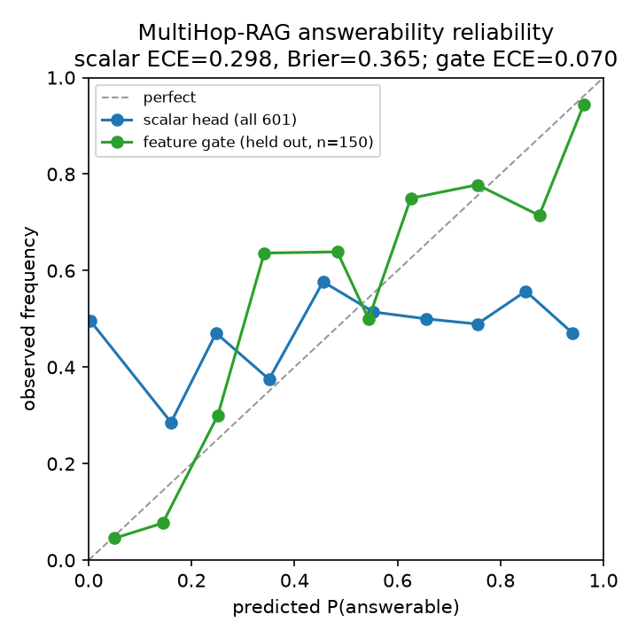

`make calibration-report` regenerates the diagram. The boundary is stated in
[`docs/findings-calibration-row.md`](docs/findings-calibration-row.md): MultiHop-RAG is the only corpus
here that labels a negative class, so the row is in-domain.

### Generator-free iteration, Stage 1 — the pool bet

The engine retrieves once. The audit's largest bet is that *iterating* — not a stronger scorer — is the
missing lever, and its first stage is testable with no model and no LLM: if a second retrieval pass,
driven by entities the first pool found but the query did not name, raises the pool's gold-fact
coverage, the mechanism is real. `make generator-free-iteration`, on 2,255 MultiHop queries,
lexical-only:

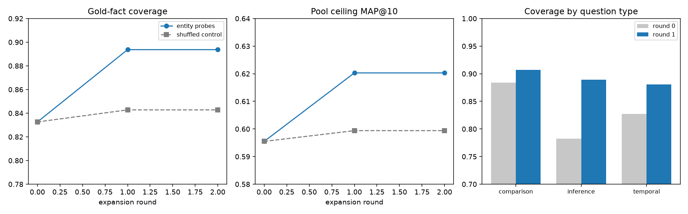

**Coverage rises 0.8326 → 0.8937 (+0.0611, p<0.0001)** and the pool's **ceiling MAP@10 0.5955 → 0.6203
(+0.0248)**; **+0.0510 coverage and +0.0210 ceiling survive a shuffled-probe control**, so it is the
bridge and not "search more". The third panel is the strongest evidence: **inference queries gain five
times what comparison queries gain** — a comparison query names both entities, so its first pool already
holds what a probe would search for. One round saturates at four probes and the pool triples (100 → 327).
The ceiling is a *bound*: no ranker has captured it here, which is the next experiment, and coverage
alone already falsified on MuSiQue.

### What compression would cost the dense channel

The dense channel stores one float32 per dimension per chunk. `make quantization-probe` measures what
int8, fp16 and product quantization cost on the **shipped encoder's own vectors** (`bge-small`, cached),
by self-retrieval against the exact scan:

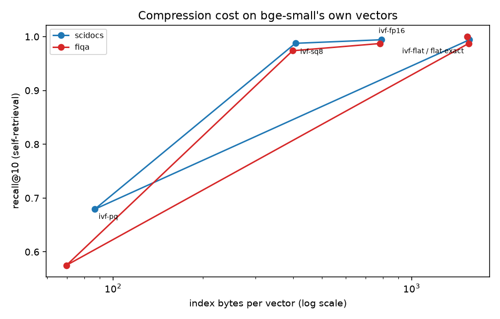

**fp16 halves the index at no measured recall cost**; **int8 is 3.8× smaller for −0.66 (scidocs) /
−1.36 (fiqa) recall@10**; **PQ m=48/8-bit is 22–32× smaller but loses 31–41 points**. These are raw
codec numbers: the engine's shipped approximate path is IVF-PQ **with `rescore 500`**, measured at 0.998
recall, so the PQ row is what compression costs, not what the engine loses.

## Running long jobs: one at a time

**Do not run two corpus-scale jobs on this machine at once.** Three multi-million-document lexical
builds plus a retrieval harness, launched together, **crashed the host**. Every one was resumable so
no work was lost, but the crash was avoidable, and this is not a preference: the jobs are I/O- and
memory-heavy enough that the combination is unsafe even on a 56-core, 256 GB machine.

The rule is now enforced, not only written down. **Twenty-six long-running tools** — the corpus
retrieval and BEIR variants, the cross-encoder caches and multi-hop harnesses, the engine harnesses,
fine-tuning/distillation, the ANN and on-disk scale benches, `bright`, `frames_eval` and
`twowiki`/`musique` — take an exclusive `flock` on `eval/.heavy-job.lock` before doing any work:

```sh
.venv/bin/python tools/heavylock.py --status    # who, if anyone, holds it
make heavy-status
```

A second job exits `2` with the holder's name, pid and start time instead of piling on. The kernel
releases the lock when a process dies, so a crashed or killed job leaves **no stale lock** to clean
up. To run two deliberately — e.g. one tiny read-only probe beside a real run — set
`LAYA_RAG_ALLOW_CONCURRENT=1`.

**Every long job checkpoints, so a crash resumes rather than restarts.** Re-issue the same command
after an interruption; the checkpoint is keyed to the run's settings *and to the index it was
measured against*, and is refused if either changed. The engine-level runners record an
`index-identity.json` beside each index naming the corpus file and the ingest knobs that built it:
re-running with a different chunk size rebuilds the index and refuses the old per-query results
rather than resuming them, which is the one way a checkpoint could previously hand back a wrong
number with a fresh timestamp.

| job | checkpoint | resume |
| --- | --- | --- |
| `tools/beir.py` lexical rows | `--lexical-checkpoint` (per query) | same command |
| `tools/beir.py` dense rows | `--embed-chunk N` (per N docs) | same command |
| `tools/twowiki.py`, `tools/musique.py` | `--embed-chunk N` (default 20,000) | same command |
| `tools/musique.py` cross-encoder | CE cache with settings check | same command |
| `tools/engine_beir.py`, `engine_multihop.py`, `engine_musique.py` | jobkit manifest | same command |
| any of them | — | `make job-status` lists what is in flight |

If a job dies mid-run, do not start a second one to "make up time": re-issue the first, let it
resume, and only then start the next.

## How it compares: the honest case

This section is the summary of every benchmark comparison made here, including the ones that
went badly. The retrieval programme behind it is in [`RANKINGS.md`](RANKINGS.md); the survey of
what could and could not be run is in [`BENCHMARKS.md`](BENCHMARKS.md). **The figures alone — nine
cross-system comparison charts, this engine against five published retrieval systems and against
the open-source field — are collected in [`docs/COMPARISONS.md`](docs/COMPARISONS.md)**, which is the
page to read if you want the picture rather than the argument. Everything below is reproducible with
`tools/beir.py`, `tools/multihop_official.py`, `tools/multihop_gate.py`, and `tools/compare.py` — the
last of which prints the tables here and draws the charts:

```sh
make beir                    # the BEIR reports the numbers come from
make charts                  # tables + error bars + docs/charts/*.png, from those reports
make charts-compare          # the cross-system comparison figures alone, no reruns
```

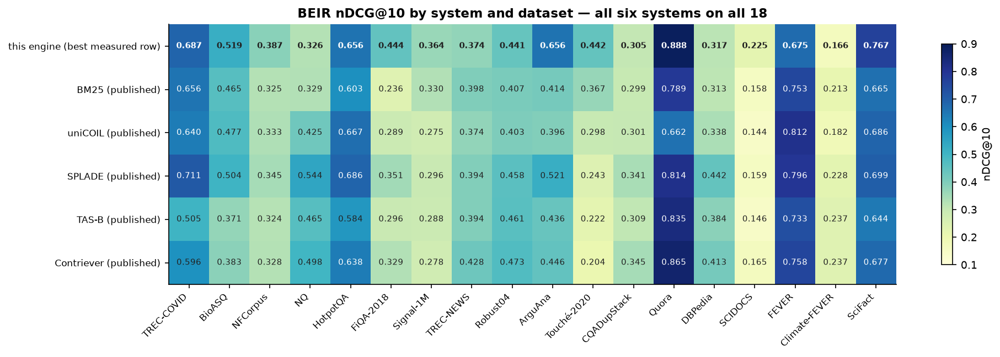

Drawing the charts needs `matplotlib` (declared in the `eval` extra), and nothing else new:
it was installed here without disturbing the pinned `torch`/`transformers`, which is worth
checking every time this venv gains a package.

The short version: **on retrieval this system is level with a 335M BGE-large if it is allowed a
configuration per dataset, and second — above SPLADE++, GTR-XL and ColBERT — with a single 33M
deployable configuration; on multi-hop it finds one piece of evidence but not all of it; and its
headline capability, calibrated abstention, did not transfer to an out-of-domain benchmark at
all.** It has no end-to-end ranking, because it does not generate text.

### What it took to make the numbers comparable

Four things had to be fixed or pinned before any of these numbers meant anything. Three of them
changed the score materially.

**1. BEIR's `ignore_identical_ids` rule was missing, and it was worth 0.19 nDCG@10 on one
dataset.** ArguAna's queries *are* corpus documents (1,298 of 1,406 share an `_id`; all 1,406
share the text), so every query retrieved itself at rank 1 and burned a top-10 slot. BEIR's
reference evaluator drops that document by default; this harness did not. Correcting it:

| ArguAna configuration | self kept (before) | BEIR rule (after) |
| --- | --- | --- |
| `bm25` control | 0.295 | **0.394** |
| `bge-small` dense, title+text | 0.428 | **0.596** |
| `bge-small` dense, text-only | 0.459 | **0.648** |
| `bge-base` dense | 0.453 | **0.638** |
| `bge-large` dense | 0.454 | **0.638** |
| fused BM25 + bi-encoder | 0.413 | **0.568** |

That single fix moved the four-dataset best-per-dataset mean from **0.448 to 0.495** and turned
"0.043 behind BGE-large" into "level with it". It also invalidated the previous conclusion that
ArguAna was an encoder-quality gap: after the fix `bge-base` scores 0.638 where a published
`bge-large` scores 0.636.

**2. The control row is now checked, not asserted.** `bm25` is the anchor that keeps an evaluator
honest, and on ArguAna it had been sitting 0.10 below the published baseline without anyone
reconciling it. `tools/beir.py` now compares it against a pinned per-dataset baseline and reports
any deviation past 0.05. All five sit inside tolerance now — SciFact −0.025, NFCorpus −0.021,
ArguAna −0.004, SciDocs −0.012, FiQA −0.002.

**3. A published baseline is convention-dependent, and the convention has to be named.** The
BEIR paper reports ArguAna BM25 at 0.315; Pyserini's 2CR table reports 0.397. The difference is
not quality: the paper's 2021 baseline indexed title and body as separate *multifield* fields,
while 2CR uses a flat index with `--remove-query` ([beir#197](https://github.com/beir-cellar/beir/issues/197)).
This harness is flat and drops the query document, so 0.397 is the number it is comparable to —
and it measures 0.394.

**4. The chunking constant moves the score more than most systems differ.** MultiHop-RAG's
official harness never states its chunk overlap (llama-index's `SentenceSplitter(chunk_size=256)`
leaves `chunk_overlap=200`). Changing only that, on identical rankings:

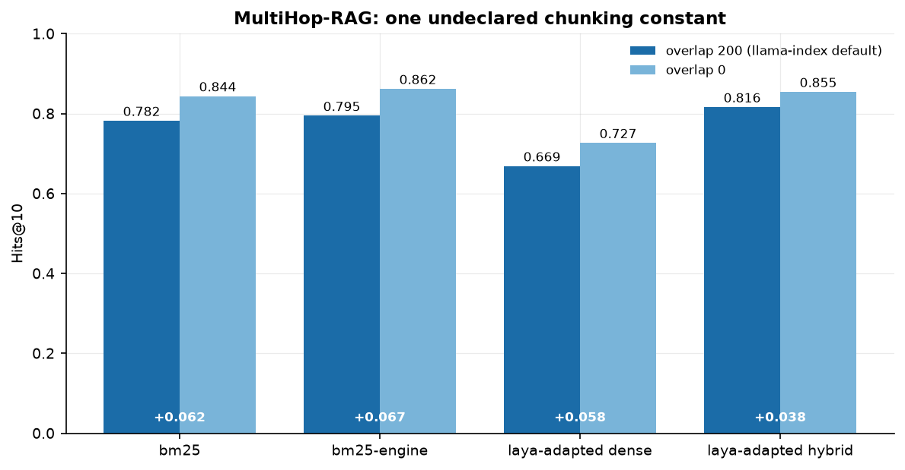

*Changing only the splitter's overlap — with the rankings held fixed — moves Hits@10 by up to
+0.067.*

Evaluating the same rankings at whole-article granularity instead of 256-token chunks gives
another ~0.08 on top. `tools/multihop_doclevel.py` is kept in the repository precisely because it
is the naive framing that flatters the system, and it is the reason this paragraph exists.

**On error bars.** Retrieval here is fully deterministic: `tools/multihop_official.py` was re-run
and reproduced its aggregates to four decimals, and every BEIR configuration reproduces exactly.
So re-running measures nothing — it costs hours and returns the same digit. The uncertainty that
matters is **sampling uncertainty over queries**: SciFact has 300 scored queries, FiQA 648,
ArguAna 1,406, and a different query draw would move the mean. Every interval below is therefore
a 10,000-resample bootstrap over the per-query scores each report persists, which is the same
machinery `evalkit.paired_bootstrap` uses for A/B tests.

### BEIR — retrieval, five datasets

Shipped `bge-small` bi-encoder, corrected evaluator, 95% bootstrap intervals over queries. The
last two columns are the multi-model dense ensemble: `bge-small` + `bge-base` + `bge-large`
fused by RRF, alone and with BM25 — a single configuration, not a per-dataset choice:

**All of BEIR's 18 datasets now have a report** — the benchmark is covered, counted from `eval/beir/`
by `make consistency-check` (which fails if any document states a different number). The five below
carry the multi-model comparison, while `nq`, `dbpedia-entity`, `quora`, `webis-touche2020`,
`hotpotqa`, `climate-fever`, `fever`, `trec-covid`, `robust04`, `trec-news`, `signal1m`,
`cqadupstack` and `bioasq` have the lexical row. The last five were the hard ones: three recovered
from a public non-gated mirror after the UKP zips went 404 (`docs/findings-beir-recovered.md`),
CQADupStack through its own twelve-sub-forum runner (`docs/findings-cqadupstack.md`), and BioASQ —
the only one that genuinely needed its free registration — through `tools/bioasq.py`
(`docs/findings-bioasq.md`).
**FEVER** is the worst outlier in the lexical control below
(**−0.121** against its published anchor). **BioASQ is the largest positive gap in it**: `bm25-engine`
reads **0.5193** against a published BM25 of **0.465**, and against the *best* of the five published
systems (**SPLADE 0.504**) by **+0.0153**. But the published-settings control reads **0.5168** — a
**+0.0518** gap of its own, within 0.0025 of the engine row — so almost none of it is a settings or
engine effect; the control and the published column simply do not agree here, and the cause is
unidentified (`docs/findings-bioasq.md`).

| dataset | queries | shipped lexical | bi-encoder | fused BM25 + bi-encoder | dense ensemble | **ensemble + BM25** |
| --- | --- | --- | --- | --- | --- | --- |
| SciFact | 300 | 0.676 | 0.720 | 0.741 | 0.754 | **0.767** |
| NFCorpus | 323 | 0.324 | 0.338 | 0.367 | 0.379 | **0.387** |
| ArguAna | 1406 | 0.417 | 0.596 | 0.568 | 0.656 | **0.651** |
| SciDocs | 1000 | 0.150 | 0.197 | 0.199 | 0.222 | **0.225** |
| FiQA-2018 | 648 | 0.239 | 0.385 | 0.382 | 0.438 | **0.444** |
| **5-dataset mean** | — | **0.361** | **0.447** | **0.452** | **0.490** | **0.495** |

**The Laya-native dense channel.** The engine's *own* encoder is now retrieval-adapted
(`make laya-finetune`) and auto-adopted as the default dense channel at
`ADAPTED_DENSE_WEIGHT=0.3`, so a fresh checkout with `models/laya-retrieval` present is
dense-native instead of lexical-only. It beats the shipped lexical column on **all five**
datasets — 4-dataset deployable mean **0.392 → 0.413** — but it is **below the `bge-small`
column it would replace** (**0.469**), and it loses to BM25 on MultiHop-RAG ordering
(MAP@10 0.2490 vs 0.2534) and on BRIGHT dense. Both configurations are therefore kept and
drawn side by side, with the `bge-small` row labelled the higher-scoring alternative. The
trade-off is stated in full in
[docs/findings-encoder-adaptation.md](docs/findings-encoder-adaptation.md).

The ensemble is the one lever in this programme that beat its estimate, and it beats it on every
corpus: against the corresponding single-model row it is +0.025 SciFact, +0.019 NFCorpus, +0.083
ArguAna, +0.026 SciDocs and +0.062 FiQA — every paired interval excludes zero — moving the
five-dataset macro mean **0.452 → 0.495 (+0.0431 [+0.0382, +0.0481])**. The honest cost is that
this is 478M parameters across three encoders and three corpus embedding passes, so the
"retrieval per parameter" claim does not extend to it; what it does show is that the ArguAna
weakness of fusion and the SciDocs shortfall are *ensemble* effects, not model-quality effects
(SciDocs 0.199 → 0.225 matches the published BGE-large number).

**The mean moves with its members by more than the margins above.** These five are five of BEIR's
eighteen, and extending them shows how much the composition carries: adding `quora` takes the fused
mean from **0.452 to 0.520**, and adding `webis-touche2020` brings it back down to **0.496**. So
"the BEIR average" is a statement about a *named set*, and a differently-sized set is a different
claim — the numbers here are always reported with their membership. Touche is also the strongest case
yet for the per-corpus lesson below: there lexical BM25 beats dense by more than two to one
(0.442 against 0.220) and fusion **loses 0.091 to BM25 alone**. See
[docs/findings-beir-breadth.md](docs/findings-beir-breadth.md).

### FRAMES — retrieval, and the same two channels swapping places

[FRAMES](https://huggingface.co/datasets/google/frames-benchmark) is 824 questions whose evidence is
English Wikipedia articles, so it is scored at document level against the articles each question
links. Retrieval only — the plan's rule when the generator dominates the variance. 814 questions over
a 2,482-article corpus built in 51 API requests:

| arm | recall@1 | recall@10 | recall@20 | MRR@10 | nDCG@10 |
| --- | --- | --- | --- | --- | --- |
| lexical (BM25, engine settings) | 0.7224 | 0.9349 | 0.9619 | 0.8028 | 0.6586 |
| dense (`bge-small`) | 0.8464 | 0.9767 | 0.9939 | 0.8931 | 0.7505 |
| **`bge-small` + `bge-base` + `bge-large` ensemble** | **0.8722** | 0.9939 | 0.9975 | **0.9193** | **0.8013** |
| ensemble fused with BM25 (RRF) | 0.8317 | 0.9939 | **0.9988** | 0.8939 | 0.7978 |

Dense beats lexical on every metric, the **ensemble beats dense** on every metric (+0.051 nDCG@10,
+0.026 recall@1), and **fusing BM25 back into the ensemble loses 0.041 recall@1** — it buys only the
last two tenths of recall@20. That is the ensemble lever confirming itself on a sixth corpus, and the
fusion lever failing on a fifth. Reproduce with
`make frames-eval FRAMES_ARGS="--ensemble-models BAAI/bge-small-en-v1.5,BAAI/bge-base-en-v1.5,BAAI/bge-large-en-v1.5"`.

FRAMES is *also* long Wikipedia text, like touche, where lexical wins by two to one. So the axis is
not length and not domain; it is the query against the document. Touche asks a short topical query of
running prose, where exact matching is strong; FRAMES asks a sentence of constraints ("the 15th first
lady's mother's first name…") against a page that names its subject once. Two sides of the reversal now
sit inside one source corpus family, which is the strongest form of this project's recurring lesson:
**route per corpus, do not configure globally.**

**Gold coverage is reported because it is not 1.0 by accident.** The dataset's links are URLs while the
corpus is keyed by canonical titles; following the API's redirects took coverage from **0.8792 to
0.9977** and moved each arm by **0.08–0.10 nDCG@10** — more than the dense-lexical gap being measured.
An unresolved gold set does not merely scale numbers down. See
[docs/findings-frames.md](docs/findings-frames.md).

Against the published field, on the four datasets an independent matrix carries for every system:

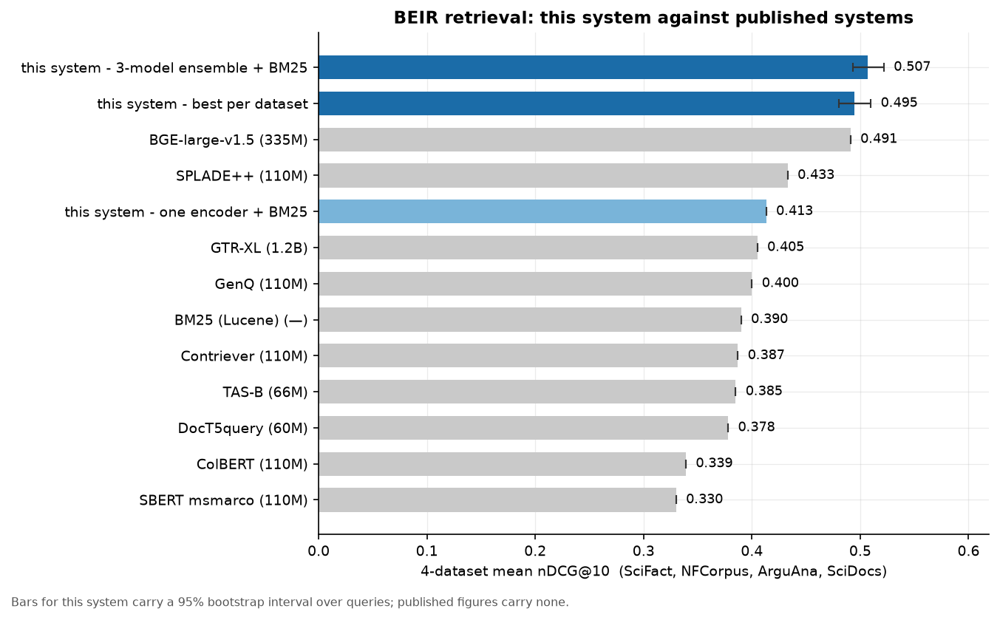

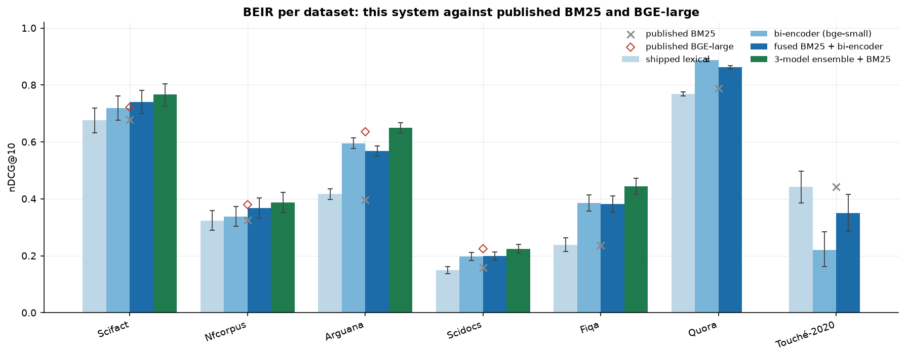

The per-dataset chart now covers **all seven datasets measured here**, against published BM25 and
BGE-large markers. It is the one to read carefully: single-model fusion is **below** the published
BGE-large marker on SciDocs, **level** with it on SciFact and NFCorpus, and only genuinely ahead on
ArguAna — while the ensemble closes SciDocs. Two things it shows that the means hide:

- **Touché-2020 is a control that passes.** Our lexical arm lands on **0.442** against a published
  BM25 of **0.442** — an independent baseline reproduced to three decimals on a 382k-document corpus,
  which is what makes the rest of the lexical rows credible.
- **Quora has no dense marker and no ensemble bar,** because no published BGE-large figure is carried
  for it and the ensemble was never run there. The gap is deliberate: a missing bar is honest, an
  inferred one is not.

The published BM25 anchors for Quora (0.789) and Touché (0.442) are pinned from the same source and
column as the original five — "Resources for Brewing BEIR" ([arXiv:2306.07471](https://arxiv.org/abs/2306.07471)),
whose BM25 column reproduces the three anchors this project already quoted (ArguAna 0.397, SciFact
0.679, FiQA 0.236) exactly.

### The lexical control, on seventeen corpora including six multi-million-document ones

The lexical arm is the only component here checkable against an independent implementation, so it is
drawn rather than assumed — and it is extended past the seven above with **ten corpora run
lexical-only**, `nq` (2.68M documents), `dbpedia-entity` (4.64M), `climate-fever` (5.42M),
`fever` (5.42M), `robust04` (528k), `trec-news` (595k), `signal1m` (2.87M),
`cqadupstack` (457k across twelve sub-forums, scored per forum and macro-averaged) and
`bioasq` (14.91M over 500 queries):

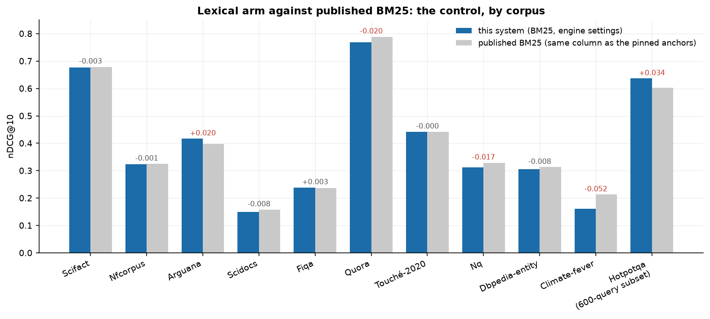

**11 of the 17 measured corpora agree within ±0.02, and 7 within ±0.008** — with Touché reproducing
its anchor to three decimals and CQADupStack landing within 0.005 of its. **BioASQ (+0.054**, the
largest positive gap measured**)**, ArguAna (**+0.020**) and HotpotQA (**+0.032** on the full 7,405
queries) sit
above their anchors; **FEVER (−0.121, the largest gap measured by far)**, TREC-NEWS (−0.063),
Climate-FEVER (−0.052), Quora (**−0.020**) and NQ (**−0.017**) sit below. An earlier version of this paragraph miscounted
these agreements, so the count is now generated by `tools/lexical_control.py` and pinned by
`make claim-check` — the sentence cannot drift from the table again.

Two explanations were tested and **both failed**, which is worth stating because the first was
plausible and I believed it:

- **Corpus size does not explain it.** Three points had suggested the gap grows with the corpus, but
  `dbpedia-entity` — chosen to test exactly that — is the largest measured at **4.6M documents** and
  sits at **−0.008**, smaller than SciDocs at a fifth its size.
- **Our lexical settings do not explain it either**, and the data to rule this out was already on
  disk. `bm25-engine` drops stopwords and stems, so the natural suspect was those choices; the `bm25`
  **control** row runs at published settings with neither, and on all five small datasets it sits
  *further* from the anchor than the engine row does (SciFact −0.025 against −0.003). If anything our
  settings help.

The cause of the two outliers is **unidentified**. The experiment that would separate "our settings"
from "these queries" — a control row on NQ itself — was started and abandoned on measured cost:
without stemming its queries run at **0.15 q/s**, roughly five hours for one diagnostic whose
configuration matches neither ours nor the published one exactly. Recorded as unrun rather than
quietly dropped.

The best-per-dataset mean is **0.495 [0.481, 0.510]** against BGE-large's 0.491, and it
cherry-picks a configuration per dataset. The **single deployable configuration**
(`bge-small` + fused BM25, 33M parameters) is **0.469**. The three-model ensemble is also a
single configuration, and it reaches **0.495 on five datasets and 0.507 on the four** — above the

Three further cross-system charts, each answering a question the score table cannot:

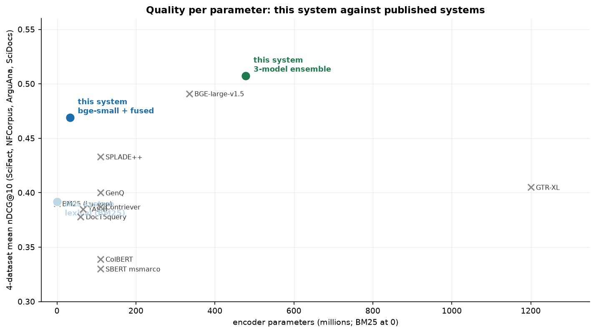

**Quality per parameter** is the axis this project can actually win, and it is not the same story as
the score table. The **33M fused arm reaches 0.469 against BGE-large's 0.491** — within 0.022 of a
335M model at a tenth of the parameters, which is the claim worth making. The 478M ensemble does
*overtake* it (0.507 against 0.491) but only by spending 1.4× the parameters, so it is a score win,
not an efficiency one. Sorting by score alone hides exactly this.

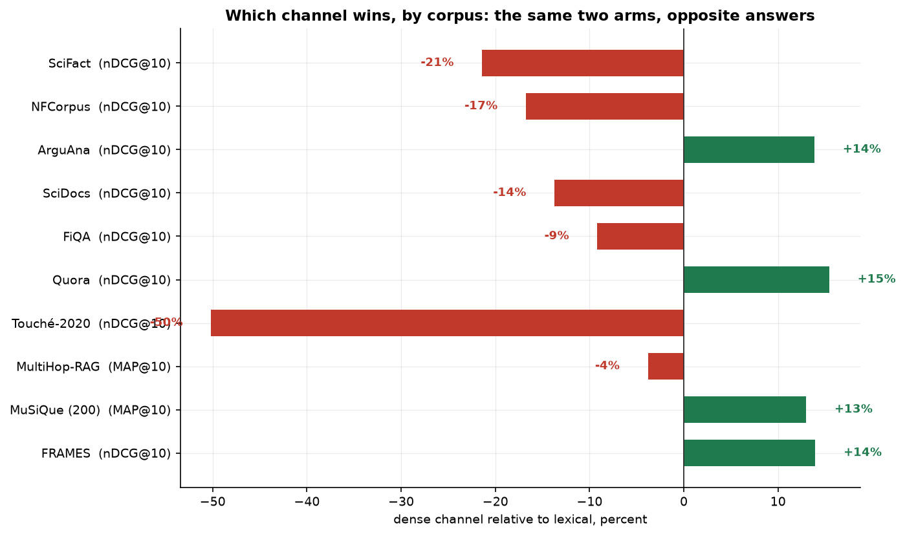

**The channel reversal** is the programme's central finding in one figure: the same two arms, ten
corpora, opposite answers. Dense wins on eight of them — most dramatically FiQA (+61%) and ArguAna
(+43%) — and loses on two, including the largest single swing in the project, Touché-2020 at **−50%**.
Each bar names its own metric because the engine rows are MAP@10 while the rest are nDCG@10; the chart
plots a percentage for that reason, not to flatter the differences.

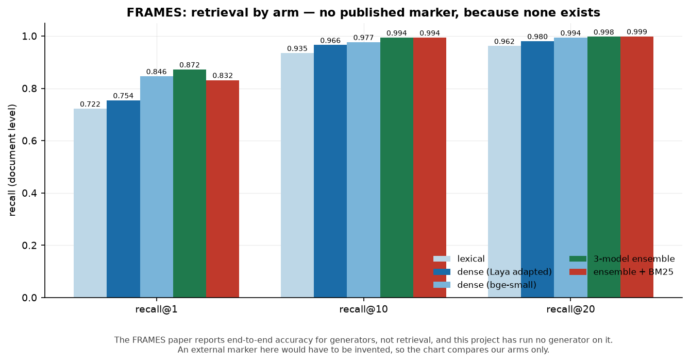

**FRAMES by arm** carries no published marker, and that is deliberate: the FRAMES paper reports
end-to-end *accuracy* for generators, not retrieval, and this project has run no generator on it. An
external marker would have to be invented.
cherry-picked mean, from stock components, with no cross-encoder. That removes the "level with a
335M BGE-large, if you pick per dataset" caveat; the remaining caveat is its parameter and
embedding cost.

Per-dataset, the honest reading is that `bge-small` + fusion is *behind* published BGE-large on
SciDocs (0.199 vs 0.225) and FiQA, *level* on SciFact and NFCorpus, and only ahead on ArguAna —
where `--dense-text-only` matters because ArguAna's "titles" are shared topic keyword lists
(titles are worth +0.034 to BM25 and cost the dense channel 0.052). The ensemble is what moves
SciDocs onto the published number.

**The per-corpus channel choice is learnable, and it recovers the cherry-picked mean.** Fusion
helps on four of the five datasets but loses on ArguAna (0.568 vs dense's 0.596), so a single
global configuration pays for ArguAna in everyone's average. `tools/beir_routing.py` splits each
dataset's queries in half, picks the channel on one half and scores the other — the router never
sees the queries it is judged on. It chooses dense on ArguAna 100% of the time and fusion on
SciFact/NFCorpus, and on the held-out halves it scores **0.4576 against the global fusion's
0.4515 (+0.0061 [+0.0026, +0.0096])** — the same 0.4576 as the oracle that picks the best channel
per dataset with the test qrels in hand. FiQA and SciDocs are statistical ties, and the router's
choices there are noise; the entire real gain is ArguAna. So "per-corpus selection" is worth about
**+0.006 on the five-dataset mean** and needs a labelled sample per corpus, not an oracle.

### MultiHop-RAG — end-to-end retrieval under the benchmark's own protocol

2,556 records over 609 news articles — 2,255 answerable queries, evidence spread across 2–4
documents, plus 301 `null_query` records whose gold answer is *"Insufficient information."* —
scored with the benchmark's own metric definitions (`tools/multihop_official.py`) against the
paper's Table 5. All rows are the `chunk_overlap=200` setting the official harness uses:

| system | Hits@10 | Hits@4 | MAP@10 | MRR@10 |
| --- | --- | --- | --- | --- |
| voyage-02 + rerank (published) | 0.747 | 0.663 | 0.480 | 0.586 |
| bge-large + rerank (published) | 0.718 | 0.636 | 0.476 | 0.563 |
| bge-large, no rerank (published) | 0.672 | 0.522 | 0.342 | 0.430 |
| **ours: coverage + document quota, reranked** | **0.896** | 0.759 | **0.319** | **0.619** |
| ours: reranked + coverage (`λ=0.7`) | 0.897 | **0.769** | 0.316 | 0.626 |
| ours: reranked + blended order (`blend=0.75`) | 0.868 | 0.748 | 0.305 | 0.632 |
| ours: cross-encoder rerank | 0.858 | 0.735 | 0.295 | 0.611 |
| ours: hybrid + coverage dedup | 0.864 | 0.712 | 0.279 | 0.567 |
| ours: hybrid, `bge-small` + BM25 | 0.802 | 0.686 | 0.251 | 0.540 |
| ours: BM25 | 0.782 | 0.638 | 0.253 | 0.550 |
| ours: `bge-small` dense | 0.708 | 0.537 | 0.186 | 0.407 |

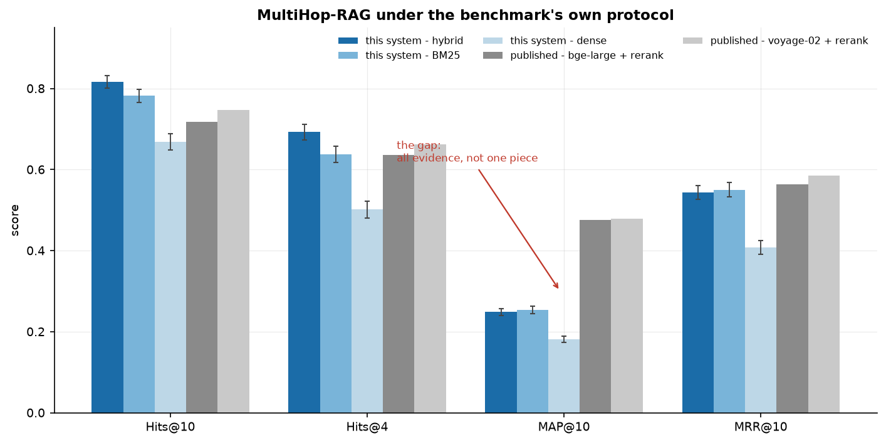

The second stage is where MAP@10 actually moved, and the chart below is the comparison with a
paired interval on every delta — the only way to read a few points on a 2,255-query set:

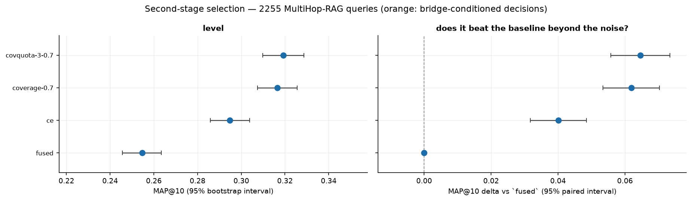

Five things to take from this, and the first is the least flattering:

- **Most of the win over the published table is lexical, not Laya.** Plain BM25 scores 0.782, above
  every published *dense* system including the reranked ones — because Table 5 contains no lexical
  baseline at all. On news text with strong term overlap, that is most of the story.
- **Hits@10 and Hits@4 beat the published reranked pipelines** from a 33M dense model. The published
  figures carry no interval, so the precise claim is that our **lower** bound is above their point
  estimate.
- **Encoder size is not the remaining lever.** `bge-large` dense beats `bge-small` dense
  (Hits@10 +0.027 [+0.009, +0.045]), but once BM25 is fused the difference vanishes:
  `bge-large` hybrid vs `bge-small` hybrid is Hits@10 **+0.008 [−0.004, +0.020]**, and `bge-base`
  hybrid is significantly *worse* on Hits@4. Fusion absorbs the encoder-quality gain.
- **MAP@10 still loses to the published reranked rows (0.319 vs 0.479), and the gap is now known
  to be *two* gaps.** See the next subsection: the achievable MAP@10 by reordering the fused pool
  is **0.609** at depth 100 — well below the 0.730 this project previously quoted, because that
  number divided by the wrong gold count. 35.4% of depth-100 pools (799 of 2,255) are missing a
  gold fact, so roughly a third of the remaining headroom is recall rather than ordering. Both levers are open.
- **`bge-small` is not a fair proxy for the published `bge-large` row** — it is *better* on this
  protocol — so the published comparison is a real head-to-head rather than a suggestive one.

#### Second-stage selection: how much headroom, and of what kind

`tools/multihop_diagnostics.py` answers the question the whole programme depends on, over all
2,255 queries:

| depth | pool fact recall | best possible MAP@10 by reordering | second-hop retention |
| --- | --- | --- | --- |
| 10 | 0.465 | 0.397 | 0.241 |
| 100 | 0.851 | **0.609** | 0.719 |
| 500 | **0.981** | **0.659** | **1.000** |

- **The ceiling rises with pool depth, and it is lower than previously reported.** Paired over
  queries: depth 10 → 100 is **+0.2118 [+0.2037, +0.2203]** and 100 → 500 is **+0.0505
  [+0.0468, +0.0544]**, both significant. An earlier version of this table reported 0.732 / 0.730
  / 0.674 — apparently flat and then falling — because the ceiling divided by the number of gold
  facts *the pool happened to match* while every rule it was compared against is scored by the
  official metric, which divides by the query's true gold count. The two agree only when the pool
  is complete, so the error inflated the ceiling on exactly the queries whose recall was failing.
  Corrected (`pool_ceiling_map(..., gold_count=...)`, with a test pinning the difference), the
  ceiling is **0.609 at depth 100** and it **rises** to 0.659 at depth 500.
- **So recall is not solved: 35.4% of depth-100 pools (799 of 2,255) are missing at least one
  gold fact.** Those queries have a ceiling of **0.4511** against the complete-pool queries'
  **0.6952**, and the fused order achieves 0.1564 on them against 0.3102 on the rest. Making every
  pool complete would raise the depth-100 ceiling from 0.6088 to about 0.6952 — **+0.086**, roughly
  **a third of the remaining headroom is recall, not ordering** — which is the opposite of what
  the old number implied.
- **The second-hop tax is still real.** Second-hop facts are retained at 0.719 in the depth-100
  pool while first-hop facts are at 0.950. The hop linked only through a bridge entity is what
  relevance-based selection discards, and it is the specific recall gap a hop-2 expansion would
  target.
- **And hop-2 expansion via term mining barely moves it.** `tools/multihop_hop2.py` mines the rare
  terms of the best-ranked candidates that the query does not already contain — the model-free
  proxy for the bridge entity — issues them as extra BM25 probes, and measures candidate-pool fact
  recall before and after. The gain is **real and significant, and marginal**: recall
  0.8480 → 0.8524, **+0.0044 [+0.0029, +0.0059]**, p=0.0010, from **32** of 2,255 queries improving
  (none worsened, 32 gold facts added of ~6,000). Set against 799 incomplete pools, the proxy
  recovers about one case in twenty-five. So recall is a live lever but not a cheap one: the
  bridge signal is validated and the *entity proxy* for it is too weak to close a third of the
  headroom, which is the argument for a model-based hop-2 over a term-based one — not for
  spending a cross-encoder on a pool this proxy barely grows.

Against that ceiling, the selection rules, all on the same cached pool (`bge-reranker-base`,
depth 100, `chunk_overlap=200`) and all paired against the fused baseline:

| rule | MAP@10 | Δ vs fused | Hits@4 |
| --- | --- | --- | --- |
| fused first stage | 0.2546 | — | 0.6825 |
| cross-encoder re-sort | 0.2948 | +0.0401 [+0.0321, +0.0484] | 0.7348 |
| **coverage + a 3-document quota** | **0.3192** | **+0.0646 [+0.0560, +0.0734]** | 0.7588 |
| cross-encoder + sentence-atom coverage (`λ=0.7`) | 0.3165 | +0.0619 [+0.0537, +0.0701] | 0.7694 |
| fitted scorer over the cached channels (held-out half, 200 queries) | 0.3102 | — | 0.7300 |
| lexical bridge-linked rescue (`β=0.3`) | 0.2780 | +0.0234 | 0.7126 |
| rank-1 guardrail, then cross-encoder | 0.2882 | +0.0336 | 0.7530 |

A note on the fitted scorer, because "learn the combination" is the obvious next idea and it was
tested. On the **full 2,255-query protocol** (1,127 held out) a logistic scorer over the
cross-encoder logit and the fused position reaches MAP@10 **0.2939**, against the cross-encoder's
**0.2881** (**+0.0058 [−0.0011, +0.0128]**, p=0.10 — not significant) and the coverage-quota rule's
**0.3147** (**−0.0208 [−0.0287, −0.0129]**, p=0.0001 — significantly worse). It does beat the fused
first stage (+0.0466, p=0.0001), so the fit is not noise; it is worth less than the rules already
measured. The earlier 400-query run added the bridge-conditioned score as a third feature and
reached 0.3102, with that feature's fitted weight **5× larger than its shuffled-bridge control's**
(+0.075 vs +0.014) — yet the held-out MAP was **unchanged** (−0.0018, p=0.51), even though the bridge
score *alone* separates the two conditions (0.1288 vs 0.0834, p=0.0006). The bridge signal is real
and redundant in this feature set. `tools/multihop_ltr.py`, `make multihop-ltr`;
`docs/findings-selector-ltr.md`.

**And a second null on the same headroom, which narrows where it can come from.** If the ordering
gap were an *optimizer* problem, a better atom weighting or a lookahead search would capture part
of it. Both were tried on the full 2,255-query protocol:

- **IDF atom weights** instead of character length — a gold fact is specific, so its terms are
  rare. Mean-over-distinct-terms is consistently *worse* (MAP@10 0.3059 vs 0.3165);
  sum-over-distinct-terms ties the best rule at **0.3195 vs 0.3192** (MAP **+0.0003
  [−0.0002, +0.0007]**, p=0.26; Hits@4 +0.0044, p=0.09).
- **Beam search** over both the global set objective and the *same* per-step objective the greedy
  rule optimizes (`coverage_beam_order`; `beam_width=1` reproduces greedy exactly) — 0.3139 and
  0.3203, neither above the 0.3280 bar.
- The 400-query subset showed IDF-sum **+0.0150 Hits@4**; the full protocol gives **+0.0044**. The
  subset gain did not replicate, which is what the deterministic-subset bar is for.
- **Per-question-type routing** (`tools/multihop_routing.py`), chosen under a two-direction nested
  protocol so every query is scored by a rule picked without it: **0.3169 vs 0.3192** globally
  selected on the same halves (**−0.0023 [−0.0056, +0.0008]**, ns). The picks are also unstable —
  `inference_query` chooses `coverage-0.5` on one half and `covquota-3-0.5` on the other, and
  `temporal_query` chooses `coverage-0.5` versus `blend-0.5`. Only `comparison_query` picks the
  same rule both ways, which is the signature of fitting noise rather than routing.

So the ordering headroom is **not** reachable by re-weighting or searching the atoms the selector
already has, nor by routing across question types. With the LTR null now confirmed at full scale and
against a shuffled-bridge control, four independent attempts to close it by optimizing over existing
features have failed: the next gain has to come from **new information** — a signal that separates
candidates the current features cannot — rather than a better optimizer over the current ones. That moves the recall and signal work ahead of further
selection-rule tuning.

- **Coverage is the lever, not ranking.** The cross-encoder alone is +0.040; making it serve a
  set objective that spends slots on *distinct facts*, with a document quota, is +0.065 — the new
  internal bar at **MAP@10 0.3192** (0.3280 on the 400-query subset). That is past the 0.2986 the
  project previously quoted as its own bar, and **still below every published row, including
  `bge-large`'s un-reranked 0.342** — the remaining gap is real and is not closed by any of the
  selection rules measured here. The winner was chosen on one half of the queries and scored on
  the other: **held-out MAP@10 0.3302** against 0.3046 for the plain cross-encoder.
- **Lexical bridge rescue does not work** — readmitting low-relevance candidates that share rare
  terms with a kept seed scored 0.278 at its best, *below* the plain cross-encoder. The bridge
  matters, but a term-overlap proxy for it is too blunt.
- **The rank-1 guardrail buys Hits@4, not MAP** (0.7530 vs 0.7348): protecting the top rank from
  a second stage helps "was anything found early" and not "was the whole set found".

Every delta above is a paired bootstrap over the same queries, and the whole comparison family is
also run through a sign-flip permutation test with Benjamini–Hochberg control
(`tools/eval_significance.py`): of 32 cells, 16 are significant after FDR, and each cell reports
the minimum detectable effect so a small non-significant delta is not read as a proven absence.

#### Bridge-conditioned relevance: the mechanism transfers, the head does not

A second-hop passage is only weakly aligned with the *query* and strongly aligned with the
entity the first hop resolved, so a relevance question asked of the query alone cannot separate
the active reasoning chain from a wrong one that shares the query's surface entity. BridgeRAG
(arXiv:2604.03384) conditions the decision on the bridge — `s(q, b, c)` instead of `s(q, c)` —
and buys it with a 70B LLM judge. This engine already owns a calibrated decision head that
answers typed questions over arbitrary state, so the same conditioning costs a third state key
and a question (`src/laya_rag/rerank.py`). It was measured, with a control arm that matters:
the same instruction text, but each query's bridge replaced by **another query's** bridge, so a
gain can be attributed to the bridge rather than to the longer prompt.

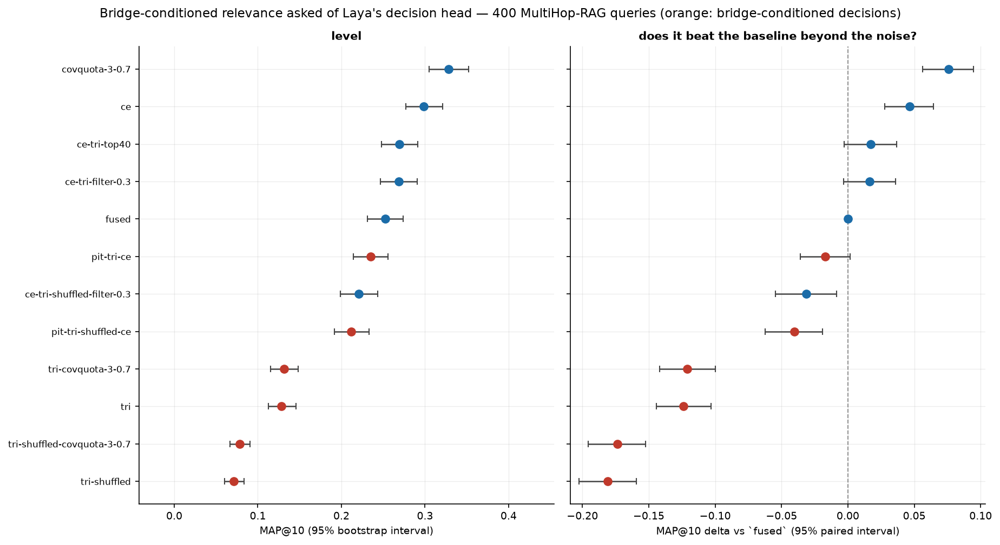

**The conditioning is real.** Over 400 queries and 40,000 pool candidates (2,664 of them
gold-matching), the true bridge separates gold facts from the rest at mean per-query **AUC
0.559** against the shuffled bridge's **0.530** — a paired difference of **+0.0293
[+0.0112, +0.0496]**, p=0.0010. Every ordering and absolute-threshold rule built on it is better
than **its own** shuffled counterpart by a similar margin, compared arm-for-arm rather than
against the wrong control: MAP@10 **+0.0570 [+0.0383, +0.0747]** for the score ordering,
**+0.0450 [+0.0298, +0.0609]** for the threshold filter, and **+0.0479 [+0.0311, +0.0642]** for
the cross-encoder order restricted to conditional survivors. Conditioning on what hop 1 found
carries information; a wrong bridge does not. One rule is the exception and it is instructive:
the *relative* top-40 cut shows no bridge effect at all (**+0.0046 [−0.0140, +0.0229]**, p=0.64),
because keeping 40 of 100 candidates barely filters anything — the effect lives in the absolute
threshold, not in a generous relative cut.

**And it is still not enough to beat the cross-encoder.** The conditional decision discriminates
at AUC 0.559 against the cross-encoder's **0.796** (−0.237 [−0.258, −0.214]), and the best rule
built on it — cross-encoder order restricted to conditional survivors — reaches MAP@10
**0.2687**, below the plain cross-encoder's **0.2986** and far below the coverage-plus-quota
**0.3280**. This is the same verdict the repository already reached for the two-way question:
Laya's decision is a good *gate* and a weak *retriever*, and asking it a better question does
not change which of those it is.

So the honest reading is a measured negative for retrieval with a positive mechanism inside it:
BridgeRAG's claim survives contact with this engine — the bridge is the right conditioning
variable — but the head that consumes it is the limiting factor, and no amount of prompt
engineering substitutes for a retrieval-trained cross-encoder. The place the validated signal
*should* pay is the answerability gate, where this engine already reaches AUC 0.815 from
retrieval and evidence-shape features; adding a bridge-conditioned column there is the next
step and is **not yet measured**. Cost of the whole experiment: ~1.5 GPU-hours, no download, no
training, no LLM.

### Replication on MuSiQue — the coverage gain does not travel

Every multi-hop number above rests on one dataset, so the obvious test is a second one.
MuSiQue (`tools/musique.py`, 2,417 validation questions over 21,098 paragraphs) is harder by
construction — its questions are built so the two supporting paragraphs cannot both be found by
matching the question's own terms — and it is the reason `tools/fetch_musique.py` exists. Gold
is the two `is_supporting` paragraphs, so MAP@10 measures the same set-coverage property.

Change in MAP@10 against each corpus's own fused first stage:

| rule | MultiHop-RAG (2,255) | MuSiQue (2,417) |
| --- | --- | --- |
| cross-encoder re-sort | +0.0401 [+0.0321, +0.0484] | +0.0180 [+0.0114, +0.0246] |
| `blend-0.75` (first stage + CE, RRF) | +0.0504 | **+0.0299 [+0.0242, +0.0357]** |
| sentence-atom coverage (`λ=0.7`) | **+0.0619 [+0.0537, +0.0701]** | **−0.0109 [−0.0181, −0.0038]** |
| coverage + 3-document quota | **+0.0646 [+0.0560, +0.0734]** | +0.0132 [+0.0063, +0.0199] |

**The coverage objective flips sign.** It is the largest single retrieval win on MultiHop-RAG and
significantly *worse than doing nothing* on MuSiQue. On MuSiQue the best rule is the plain
`blend-0.75` — by **+0.0167 [+0.0133, +0.0201]** over the coverage-plus-quota rule that leads on
MultiHop-RAG. So "coverage is the lever" is a statement about one dataset, not about multi-hop
retrieval, and the README's earlier framing of it as the general fix was too strong.

What does travel is the *second stage* and the *quota*:

- **The cross-encoder generalises** (+0.0180, significant) — worth noting because on BEIR the same
  class of model lost on all five corpora. Its value is corpus-dependent in sign there and
  positive here.
- **The document quota is what makes coverage robust.** Removing it takes coverage from −0.0109 to
  +0.0132 on MuSiQue, and on MuSiQue the quota wins on *both* MAP@10 and Hits@4
  (covquota vs coverage: **+0.0241 [+0.0204, +0.0279]**). On MultiHop-RAG the same swap buys MAP
  (+0.0027 [+0.0002, +0.0052]) and costs Hits@4 (−0.0106 [−0.0195, −0.0018]) — which is the trade
  that keeps `RERANK_COVERAGE_MIN_DOCS` at `0` by default.
- On MuSiQue, 2 of the 4 rules beat the first stage and 1 is significantly worse; on MultiHop-RAG
  all 4 win. The direction of a selection rule is not a property of the task, it is a property of
  the corpus.

**The practical consequence.** `RERANK_COVERAGE_LAMBDA` auto-resolves to `0.7` — plain coverage —
when a cross-encoder is configured, and that default is a bet on MultiHop-RAG-shaped corpora. A
deployment on MuSiQue-shaped data (small gold sets, harder second hops) would be better served by
`RERANK_COVERAGE_MIN_DOCS=3`, which is positive on both corpora. The default is left as it is
because changing it costs Hits@4 where the project's headline numbers live, but it is a
documented trade rather than a settled answer.

### 2WikiMultiHopQA — recall is saturated, and the coverage objective does not travel

The 2Wiki adapter indexes the **distractor context pool** — all 56,651 paragraphs the dev split
provides — and retrieves the supporting paragraphs inside it, so this is a retrieval measurement, not
a provided-context generator score. It runs the channel arms and the coverage rule family.

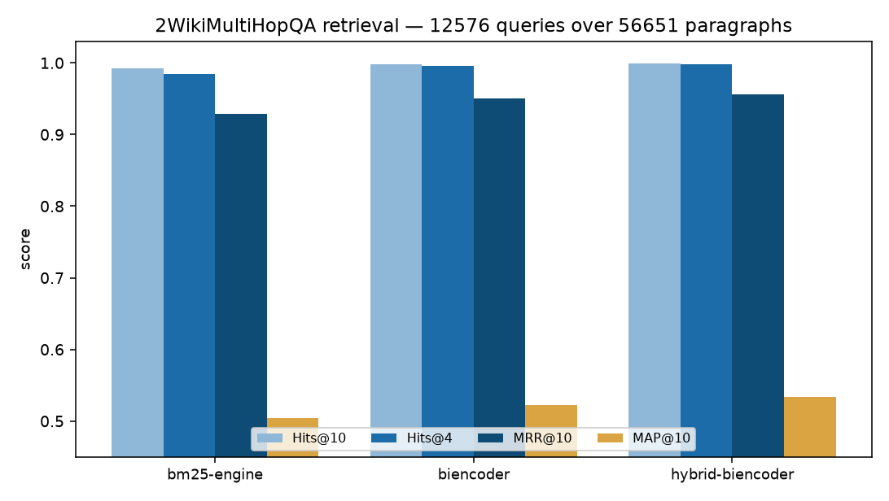

| arm | Hits@10 | Hits@4 | MAP@10 | MRR@10 |
| --- | --- | --- | --- | --- |
| bm25-engine | 0.9927 | 0.9848 | 0.5037 | 0.9293 |
| biencoder (`bge-small`) | 0.9986 | 0.9959 | 0.5223 | 0.9505 |
| **hybrid-biencoder** | **0.9997** | **0.9986** | **0.5337** | **0.9564** |
| coverage-0.7 | 0.9997 | 0.9984 | 0.5291 | 0.9484 |
| covquota-3-0.7 | 0.9997 | 0.9979 | 0.5282 | 0.9454 |

**Hits@10 is 0.993 while MAP@10 is 0.504** — the pool almost always contains the gold, and the score
is lost in the order it comes back in. A retrieval-trained bi-encoder beats the lexical arm
(**+0.0186 MAP@10**) and RRF fusion adds again (**+0.0300**, all p<0.0001).

**And the coverage rule loses here.** On MultiHop-RAG the set-coverage objective is the project's
headline retrieval win; it **falsified on MuSiQue** (−0.0109 MAP@10); on 2Wiki it falsifies again —
coverage **−0.0046** and covquota **−0.0056** MAP@10 against the fused order handed to them (both
p<0.0001), while preserving Hits@4 (−0.0002, ns). So the MuSiQue failure is **not idiosyncratic**:
the rule trades ordering for coverage, and on a corpus where Hits@10 is already 0.9997 there is
nothing left for coverage to buy and only the ordering cost remains. (The relevance term here is the
fused RRF score, not a cross-encoder — a narrower test than MuSiQue's, stated in the finding.)

### Negative rejection — the claim that did not survive

This is the one that should change how the project describes itself. MultiHop-RAG's 301
`null_query` records are the hard negatives this engine's answerability gate exists to reject.
Run through `RagEngine.query` on the indexed corpus with the shipped thresholds, against an equal
sample of 300 answerable queries:

| group | n | abstained | rate |
| --- | --- | --- | --- |
| `null_query` — abstention is **correct** | 301 | 93 | **30.9%** |
| answerable — abstention is an **error** | 300 | 86 | 28.7% |

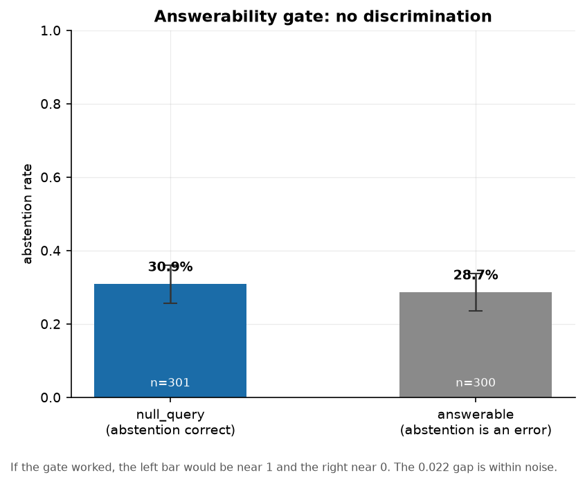

**The gate does not discriminate on this corpus.** A 0.022 difference, against a standard error of
about 0.037 — it behaves like a fixed ~30% abstention policy rather than a decision about the
evidence. That measurement used the shipped threshold, which leaves the two candidate explanations
open: a *head* with no signal, or a *threshold* that is wrong for this domain. `tools/multihop_recalibrate.py`
separates them by treating MultiHop-RAG as the out-of-domain split, fitting a threshold — and a
monotone Platt rescaling — on one half of the null/answerable queries, and scoring the other half:

| reading | null abstain | answerable abstain | gap | balanced accuracy |
| --- | --- | --- | --- | --- |
| shipped threshold 0.5 (all queries) | 0.309 | 0.287 | +0.022 | 0.511 |
| held-out half, calibrated threshold | 0.272 | 0.293 | −0.022 | 0.489 |
| held-out half, threshold fit on it (oracle) | 0.676 | 0.627 | +0.049 | 0.524 |

Three readings, all pointing the same way:

- **The head's probability ranks the two classes at chance.** ROC-AUC over all 601 queries is
  **0.509 [0.463, 0.555]**; restricted to the 506 queries that actually reached the head (the
  `p = 0` rows are the relevance gate short-circuit, not a head output) it is **0.529 [0.479,
  0.579]**. Both intervals include 0.5.
- **A Platt rescaling fitted on the calibration half has a negative slope (−0.18)** — if anything
  the head's probability points the wrong way on this corpus, so there is no signal to rescale.
- **A threshold fitted on one half does not transfer.** Across 300 stratified half-splits, the
  held-out balanced accuracy is **0.511 [0.472, 0.548]** — chance. Even the oracle threshold
  chosen on the test half itself only reaches 0.524 balanced accuracy.

The caveats cut both ways (the dense channel was `bge-small` rather than Laya's encoder, and these
negatives are the *hard* kind, where every entity named genuinely appears in the corpus), but the
conclusion is now stronger than the original one: **this is not a miscalibrated threshold, it is
the absence of a transferable signal.** Abstention remains a property of a calibrated corpus.
Claiming it on any external benchmark requires a head trained or calibrated on that domain — and
recalibrating this one on a held-out MultiHop split does not produce discrimination, so the gate
should not be cited as a strength out of domain.

### Where this RAG is better

- **Retrieval quality, with and without the parameter budget.** The 33M `bge-small` + fused BM25
  configuration is 0.452 on five BEIR datasets — ahead of SPLADE++, GTR-XL (1.2B) and ColBERT, and
  level with a 335M BGE-large. The three-model dense ensemble, still with no cross-encoder, is a
  single configuration at **0.495 (five datasets) / 0.507 (four)**, above the published BGE-large.
  The first number is the per-parameter claim; the second trades 478M parameters for quality.
  Fusion contributes most of it, and fusion is significant against the stemmed lexical channel on
  all five datasets (+0.043 to +0.151).
- **Multi-hop recall breadth.** Best Hits@10 and Hits@4 measured on MultiHop-RAG — 0.864 and
  0.712 after the coverage pass — including against reranked published pipelines.
- **Abstention and citation checking as first-class outputs**, which no IR leaderboard scores.
  The engine returns calibrated probabilities and can abstain; `verify.py` checks citations and
  quoted spans deterministically, with no model and no threshold, so it cannot be wrong in the
  way a model can. `make trust-report` states those surfaces together with their measured numbers —
  a planted poison leak rate of 0.20 falling to **0.00** at **zero** false refusals, tenant
  isolation and anonymous denial holding, and the 12-feature gate's false-accept rate at 80%
  coverage at **0.4069** against the shipped scalar's 0.5099
  ([`docs/findings-trust-report.md`](docs/findings-trust-report.md)).
- **No hallucination surface by construction.** It cannot generate, so it cannot invent facts.
  That is a real property, not a marketing one, and it is invisible on any leaderboard.
- **It runs anywhere.** No GPU, no API key, fp32 on CPU with Metal when present, a 2–5 s query
  and a few hundred MB of index.

### Where this RAG is worse

- **Coverage on multi-hop queries — and it does not replicate.** MAP@10 **0.3192** against 0.479
  published, after a coverage-plus-quota pass over cross-encoder scores lifts it
  **+0.0646 [+0.0560, +0.0734]** over the fused baseline (0.2546) *on MultiHop-RAG*. On MuSiQue
  the same coverage pass is significantly **worse** than the fused first stage
  (**−0.0109 [−0.0181, −0.0038]**) and the best rule is a plain cross-encoder blend. The
  dataset-robust part is the second stage and the document quota, not the coverage objective —
  see the replication subsection above. It still finds *an* answer passage far more reliably than
  *the set*. **The gap is partly recall and partly selection, and the split is now measured:**
  the achievable MAP@10 by reordering the fused pool is **0.609** at depth 100 (not the 0.730
  quoted before — see the diagnostics subsection for the normalisation fix), and it **rises** to
  0.659 at depth 500. **35.4% of depth-100 pools (799 of 2,255) are missing at least one gold
  fact** (ceiling **0.4511** for those queries against **0.6952** for the complete ones), so making
  every pool complete would add roughly **+0.086** to the ceiling — about a third of the rest.
  Second-hop facts are retained at 0.719 in that pool against 0.950 for first-hop facts, which is
  the specific recall gap a hop-2 expansion targets. The published 0.479 is a *reranked* number;
  this engine's best reranked configuration is 0.3192 (`RERANK_COVERAGE_LAMBDA=0.7` plus a
  3-document quota), held-out on the unseen half at 0.3302.
  Reports: `eval/benchmarks/multihop-rag/coverage-nored.json`, `coverage-set.json`,
  `rerank-experiment-full.json`, `diagnostics.json`, `ltr.json`.
- **Answerability's shipped single scalar out of domain** — AUC 0.51 at the best, and a
  recalibration split fitted on MultiHop-RAG itself transfers at chance. The signal is not
  absent, though: a feature gate over the retrieval and evidence signals the engine already
  has scores **held-out ROC-AUC 0.815** (balanced accuracy 0.725) on a fresh 300-query
  MultiHop split where the scalar scores 0.520 — but that is a **within-question-type**
  number: with a whole question type held out it falls to **0.767** [0.671, 0.827], worst on
  comparison questions (0.664). The fix is to recalibrate on the target domain —
  `tools/answerability_train.py` (see `--group-by`), `LAYA_RAG_ANSWERABILITY_GATE_PATH` — not
  to trust the scalar.
- **No generation of its own.** The four generation-facing targets are each blocked for a
  *different* reason, so "no text generation" is shorthand rather than the whole story: MTEB
  scores a submitted encoder, not text; HHEM ranks hallucination *detectors*, which the engine
  is not; KILT and the TREC RAG track both want generated prose, which `compose.py` can
  supply — but KILT additionally needs an entity linker, TREC needs NIST corpus and gold-nugget
  access, and either leaderboard row would score the attached LLM. Any end-to-end answer
  accuracy is `engine + <model>`, never the engine's.
- **Laya's own encoder is unadapted for retrieval, not merely useless** (nDCG@10 ≈ 0.014 on
  SciFact against BM25's 0.654), so the shipped default is lexical-only and reaching competitive
  dense retrieval means supplying `bge-small`. A closed-form ridge projection distilled from
  `bge-small` document embeddings lifts that 0.014 to **0.0810** (5.7×) on SciFact — see
  `tools/projection_head.py` — so the representation carries signal and the remaining gap is the
  query encoder. The engine's differentiating model is still a *decision* model, and the shipped
  retrieval quality still comes from stock components until an encoder is trained and packaged.
- **Cross-encoder reranking is corpus-dependent, not a general loss.** `bge-reranker-base` over
  the fused top-100 lowered nDCG@10 on all five BEIR datasets — catastrophically on ArguAna
  (0.568 → 0.250), where relevance is an *opposition* relation a pointwise ranker does not model
  — but on MultiHop-RAG the same reranker is the **largest single lever measured**: MAP@10
  0.2522 → **0.2986** (+0.0464 [+0.0275, +0.0655]), Hits@4 0.6625 → **0.7225**, Hits@10 → **0.8600**,
  MRR@10 → **0.6010** on a deterministic 400-query subset, every paired interval excluding zero.
  The second stage therefore belongs to per-corpus routing (and blending via `RERANK_BLEND`),
  not a global on/off.
- **Scale.** The default backend holds every chunk's text and vector in memory and the postings
  are Python dicts. `INDEX_BACKEND=ondisk` streams vectors to a memory-mapped file and packs BM25
  postings into one mmap, with chunk text read on demand, so query-time memory stops scaling with
  corpus size; the build block is token-capped so construction memory stops scaling with document
  length either. The largest BEIR corpora (BioASQ 14.9M, FEVER 5.4M, NQ 2.7M documents) still need
  streaming *ingestion* and an on-disk term dictionary and chunk-id list; five of eighteen datasets
  is the honest measured coverage.
- **SciDocs** is the weakest dataset for the single-model configuration (0.199 vs a published
  0.225); the three-model ensemble reaches 0.225, so the shortfall there is a single-encoder
  effect rather than a corpus the pipeline cannot handle. Turning on the retrieval query
  instruction lifts the single `bge-small` encoder to **0.2052** on cached embeddings, and
  `--dataset-models` / `--dense-text-only-datasets` let a per-corpus encoder be routed to it.

### Experiments that did not work

Recorded so they are not retried from intuition:

| experiment | result | verdict |
| --- | --- | --- |
| BM25 pseudo-relevance feedback (10 docs, 15 terms ×2) | SciFact 0.682 → 0.424 | rejected — the expansion drifts short queries badly |
| Passage-level indexing (600-char, max-pool) | SciFact 0.682 → 0.659; TREC-COVID 0.306 → 0.245; **Robust04 0.408 → 0.352; TREC-NEWS 0.335 → 0.246** | rejected at abstract size, **and now rejected on genuinely long documents too** — the two corpora the caveat waited for |
| Score fusion (CombSUM, max-normalised) | SciFact 0.712 vs RRF's 0.741 | rejected — BM25 and cosine scales do not normalise against each other, which is what RRF avoids |
| `bge-large` instead of `bge-base` | ArguAna 0.6377 → 0.6378 | no gain for 3× the embedding cost — encoder size saturates at 110M here |
| Cross-encoder reranking (MiniLM-L6) | SciFact 0.691 vs fusion's 0.741 | rejected against a now-stronger first stage |
| Cross-encoder reranking (`bge-reranker-base`, fused top-100) | SciFact 0.741→0.714, NFCorpus 0.367→0.315, ArguAna 0.568→0.250, SciDocs 0.199→0.152, FiQA 0.382→0.328 | rejected — hurts all five; ArguAna's opposition relation breaks a pointwise ranker |
| Laya's decision head as a *re-ranker* | SciFact 0.654 → 0.470 | rejected — it is calibrated as a filter and gate, not an orderer |
| Title weighting (`bm25-title`) | SciFact +0.006, NFCorpus +0.000, FiQA 0.000, ArguAna +0.011 | kept, but only significant on ArguAna — "helps slightly" was over-claimed |
| `bge-base` instead of `bge-small` on MultiHop-RAG | hybrid Hits@10 0.802 → 0.799, Hits@4 0.686 → 0.668 | rejected — significantly worse on Hits@4, no MAP gain |
| Calibrated abstention, out of domain | AUC 0.509; half-split transfer 0.511 balanced accuracy | does not transfer — no signal to recalibrate |
| Full-split fine-tuning (110,575 pairs + 5,180 mined hard negatives) | NFCorpus 0.3385 → 0.3285 (−0.0100) | rejected — scaling the 20k run up with naively mined negatives hurt |
| Document-level MMR (`doc-mmr`) | MAP@10 0.255 → 0.274 | kept as a lever, but below cluster-dedup's 0.279 |
| Lexical bridge-linked second-hop rescue (`rescue-0.3/0.5/0.7`) | MAP@10 0.2780 / 0.2706 / 0.2683 vs the cross-encoder's 0.2948 | rejected — readmitting low-relevance candidates because they share rare *terms* with a kept seed is a blunt proxy for the bridge relation; the cross-encoder is better without it |
| Rank-1 guardrail before the cross-encoder | MAP@10 0.2882 vs 0.2948, but Hits@4 0.7530 vs 0.7348 | kept as a Hits@4 option, not a MAP lever — protecting rank 1 trades set coverage for early precision |
| Bridge-conditioned relevance `s(q, b, c)` (BridgeRAG's mechanism, no LLM) | AUC 0.559 vs the shuffled-bridge control's 0.530 (**+0.0293 [+0.0112, +0.0496]**), and every rule beats its control — but the best rule reaches MAP@10 0.2687 vs the cross-encoder's 0.2986 and the coverage-quota 0.3280 | the conditioning works and the head is still the limit — a validated signal for the *gate*, not a retrieval lever. See the bridge subsection above |
| Late interaction (MaxSim) over Laya's own token states | MAP@10 **0.1132** vs the fused order's 0.2680 (**−0.1548 [−0.1862, −0.1238]**); Hits@4 0.3250 vs 0.6850 | rejected — and the cost closes the question independently: the encoder emits **337 tokens per chunk** on average, so a multi-vector index is **1,010 KiB per chunk** (~963 GiB per million documents at fp32, 241 GiB int8) against 3 KB for one pooled vector |

**On the late-interaction probe.** The token states *are* available from the shipped checkpoint
(`agent.model.encoder(...).last_hidden_state`, 768-dim), so ColBERT-style retrieval is
implementable here with no download — but the encoder is a decision model's, not a
retrieval-trained one, and MaxSim over its tokens inherits exactly the weakness the pooled
embedding has, at ~337× the storage. That combination is what closes DISCo's collective-coverage
index as a route for this engine: the indexable submodular objective needs token-level vectors to
be worth indexing in the first place. `make laya-maxsim-probe`, ~8 minutes on MPS.

### What would raise the score — measured

The ordered list that stood here has been run item by item. `RANKINGS.md` carries the full
measurements; each item is a `make` target. In the priority order they were ranked:

| # | item | outcome |
| --- | --- | --- |
| 1 | **`bge-large` under the MultiHop-RAG protocol** | **Done.** Dense improves with size — Hits@10 +0.027 [+0.009, +0.045] over `bge-small` — but the fused hybrid does not: +0.008 [−0.004, +0.020], with `bge-base` hybrid significantly *worse* on Hits@4. Encoder size is not the MAP gap. |
| 2 | **Recalibrate the answerability head on a held-out split** | **Done, negative.** ROC-AUC 0.509 [0.463, 0.555]; a threshold fitted on one half transfers at 0.511 [0.472, 0.548] balanced accuracy; Platt slope −0.18. There is no signal to recalibrate. |
| 3 | **Attack MAP@10 with a coverage objective** | **Done, and it is the largest single retrieval win.** Skipping a fused candidate whose cosine to a kept chunk is ≥ 0.9 lifts MAP@10 0.251 → **0.279** (+0.0244 [+0.0223, +0.0265]) and Hits@10 0.802 → **0.864**. Now `RECALL_DEDUP_THRESHOLD` in the engine (off by default). |
| 4 | **`bge-reranker-base` over the fused top-100** | **Done, and it is a decisive negative.** Reranking the fused top-100 *lowered* nDCG@10 on all five datasets — SciFact 0.741 → 0.714, NFCorpus 0.367 → 0.315, SciDocs 0.199 → 0.152, FiQA 0.382 → 0.328, and **ArguAna 0.568 → 0.250 (−0.318)**. Every paired interval excludes zero. The earlier rejection holds against the stronger first stage; a pointwise MS MARCO cross-encoder does not model ArguAna's opposition relation. |
| 5 | **Multi-model dense ensemble** (`bge-small` + `bge-base` + `bge-large` by RRF) | **Done, and it beat its estimate on every corpus.** +0.025 / +0.019 / +0.083 / +0.026 / +0.062 nDCG@10 on SciFact / NFCorpus / ArguAna / SciDocs / FiQA, all significant; the five-dataset mean moves 0.452 → **0.495** (+0.0431 [+0.0382, +0.0481]) and the four-dataset mean to **0.507**, above the previously cherry-picked 0.495. Cost: 478M parameters and three embedding passes. |
| 6 | **Per-corpus channel selection** | **Done.** A router calibrated on half of each corpus scores 0.4576 against global fusion's 0.4515 on the held-out halves (+0.0061 [+0.0026, +0.0096]) — exactly the oracle. The gain is ArguAna, which it picks 100% of the time. |
| 7 | **Full fine-tuning** on 110k in-domain pairs | **Done, negative.** The whole 110,575-pair NFCorpus train split, one epoch, plus 5,180 mined hard negatives: adapted nDCG@10 **0.3285 vs zero-shot 0.3385 (−0.0100)**. The earlier 20k-pair +0.0085 was not a floor — scaling it up with naively mined negatives *hurt*. |
| 8 | **On-disk postings and streaming index construction** | **Infrastructure landed.** The full 171,332-document TREC-COVID corpus builds packed, memory-mapped postings in 128 MB with byte-identical ranking. The build block is token-capped, which cut peak RSS on a 30k×200-token synthetic corpus from 1,045 MB to 453 MB at the same speed, and the merge is a heap over the sorted runs. The streaming dense index writes vectors without accumulating them — peak RSS flat at 1,249 MB from 5k to 15k documents once padding is fixed-length (the first version grew to 4.5 GB because torch's MPS graph cache keys on tensor shape). 10M+ corpora still need an on-disk term dictionary and chunk-id list. |

Four of the eight changed a claim rather than adding a number. **Item 2** turned "the gate does
not discriminate" into "the gate has no signal to calibrate" — a stronger and more useful
negative. **Item 1** removed the last reason to think a bigger encoder would fix the multi-hop
MAP@10 gap: it is a coverage failure, and **item 3**'s model-free diversity pass is what moved
it, at a fraction of the cost of the published reranked pipelines. **Items 4 and 7** both
reversed their expectations from the standard literature: `bge-reranker-base` at depth 100 lost
nDCG@10 on every dataset, and full-split fine-tuning with mined hard negatives scored *below*
zero-shot. Neither is a floor to be scaled. The item that paid off most beyond its estimate is
**item 5**.

### What cannot be claimed

There is **no end-to-end RAG ranking**: the first `engine + <generator>` row exists only as a
**pilot** (12 answerable + 8 null records, local `ornith-1.5:35b`), where EM 0.000 sits beside a
0.667 gold-containment rate on the same answers and ~36 s/query puts the full row at 22–25 h on this
host — see [`docs/findings-endtoend-pilot.md`](docs/findings-endtoend-pilot.md). There is **no KILT,
HHEM or TREC RAG placement**, and **no MTEB placement either**: MTEB is now *representable* — the
engine implements MTEB v2's `SearchProtocol` (`make mteb-eval`) — but a full evaluation forked the
harness workers and stalled, so there is no score and no upload. **Answerability is not portable**, as
measured above, **and not usable as a probability out of domain**: on the only labelled negative class
here the shipped scalar is at chance (AUC **0.5087**, ECE **0.3085**), and the calibrated 12-feature
replacement is a measured in-domain gate, not a shipped default. **The pool bet's ceiling is not
realized**: entity-probe expansion raises gold coverage and the oracle ceiling, but no ranker here has
converted that into MAP@10, and coverage alone already falsified on MuSiQue. **All eighteen of BEIR's
datasets are measured**, so unlike every previous round there *is* a BEIR-18 average: **0.4799** over
the engine's best measured row per dataset (it was 0.4665 before the title-weighted and adapted-dense
pass below) — above SPLADE's **0.4740**, the strongest of the paper's five published systems. Read that
against the right baseline: each of our cells may use a different configuration, so this is a
best-per-dataset figure and measures what per-dataset routing reaches, not one deployable setting, and
the published systems are single configurations. Nine cells moved: **TREC-COVID 0.6188 → 0.6871**,
**ROBUST04 0.4077 → 0.4405** and **TREC-NEWS 0.3351 → 0.3745** from the adapted dense channel fused at
weight 0.3; **FEVER 0.6323 → 0.6749**, **NQ 0.3118 → 0.3264**, **DBPedia 0.3053 → 0.3166**,
**HotpotQA 0.6352 → 0.6563**, **CQADupStack 0.2988 → 0.3046** and **Climate-FEVER 0.1610 → 0.1657**
from title-weighted BM25. Every other cell is unchanged, and the title row was a no-op or worse on
ROBUST04, Signal-1M, Quora and Touché-2020. In every closed cell the row recorded before the pass
reproduces exactly (SciFact 0.6762, FEVER 0.6323, HotpotQA 0.6352, CQADupStack 0.2988), so the new rows
are comparable rather than merely higher. **On FEVER, genuine per-field weighting does better than title
repetition**: `bm25f` — separate length normalisation and weight per field — reads **0.7288** against the title
row's 0.6749 and the flat control's 0.6323, which is **−0.0242 from the published anchor instead of −0.121**.
The title-repeat trick was a cheap approximation of the same idea; the field-weighted row is what the published
column actually does.
**Stronger scorers did not pay off here**: besides the pointwise reranker and the failed fine-tune
listed above, all three Phase 2 ordering heads lost to the baselines they targeted (topical late
interaction, relational NLI stance, and a cross-encoder adapted on MuSiQue's own train pairs). And any
faithfulness or answer-accuracy figure produced with the local 35B model is a statement about that
model, not about this engine; it is labelled that way wherever it appears. `BENCHMARKS.md` carries the
full per-benchmark verdict for the rest of the landscape.

## Repository layout

```
laya-rag/
├── src/laya_rag/          Python engine
│   ├── config.py            environment-driven configuration
│   ├── chunking.py          document loading and paragraph-aware chunking
│   ├── model.py             Laya agent, plus optional bi-encoder and cross-encoder
│   ├── index_store.py       persistent normalised vector index
│   ├── lexical.py           BM25 channel and reciprocal rank fusion
│   ├── rerank.py            relevance filtering and ordering, answerability gate
│   ├── engine.py            orchestration: index, hybrid recall, evidence bundle
│   ├── compose.py           optional answer composition (the one non-Laya step)
│   ├── verify.py            deterministic citation, quote, numeric and injection checks
│   ├── trust.py             trust tiers and the per-tenant path ACL
│   ├── audit.py             hash-chained log of index mutations, with an actor
│   ├── extractive.py        citation-first extraction: verbatim spans, structured citations
│   ├── api.py               FastAPI service
│   ├── cli.py               `laya-rag` command line
│   └── web/                 the GUI: static HTML/CSS/JS, no build step
├── tools/                 gui-smoke.mjs; evalkit.py, eval.py, bench.py, beir.py,
│                          beir_ablate.py, beir_routing.py, beir_coverage.py,
│                          engine_beir.py, ann_bench.py, sparse.py,
│                          finetune.py, distill_eval.py, package_model.py,
│                          gate_calibration.py, gate_extra_features.py,
│                          bench_index_parallel.py, bench_biencoder_parallel.py,
│                          ondisk.py, compare.py (cross-system tables,
│                          error bars, charts), diagram.py (the architecture diagram),
│                          make_social_card.py (the repository social preview card),
│                          the multiHop harnesses (multihop_official.py,
│                          multihop_gate.py, multihop_recalibrate.py,
│                          multihop_coverage.py, multihop_doclevel.py,
│                          multihop_diagnostics.py, multihop_ce_cache.py,
│                          multihop_rerank_experiment.py, multihop_atom_index.py),
│                          eval_significance.py,
│                          answerability_train.py, answerability_features.py,
│                          adversarial_audit.py, bright.py, beir_atom_channel.py,
│                          generation_eval.py, context_prefix_eval.py, bench_lexical.py,
│                          consistency_check.py (the cross-document gate),
│                          claiming/coverage tools (claim_check.py, audit_verify.py,
│                          nugget_recall.py, leakage_audit.py, labelling_queue.py),
│                          calibration_report.py, mteb_search.py, musique.py, twowiki.py,
│                          generator_free_iteration.py, quantization_probe.py,
│                          charts_pass.py, heavylock.py (the one-heavy-job lock)
├── docs/                  `index.md` (the guide index), generated figures, `FINDINGS.md`
│                          (the index of every measured result), and the per-topic findings
│                          documents
├── tests/                 Python suite, real-weights suite, metrics and adversarial checks
├── models/                Laya checkpoints (gitignored)
├── indexes/               persisted indexes (gitignored)
├── eval/                  generated evaluation reports and caches (gitignored)
└── vendor/                submodule: laya (pinned v0.4.0)
```

## Known limits

These are measured, by `make eval` and `make bench`, rather than inferred. The numbers come from
the planted corpus and the synthetic scale run and will move with a different corpus or checkpoint.

**A fact longer than the chunk overlap can be lost, not merely truncated — but the guaranteed
length is now the overlap, and sentences are never split.** A fact no longer than
`CHUNK_OVERLAP_CHARS` (400 by default) is intact in at least one chunk at any split distance, and
`chunk_text` backs a cut that lands inside a sentence up to that sentence's start, so a whole
sentence up to `CHUNK_CHARS` survives even when it is longer than the overlap. The 290-character
fact that the old 200-character overlap lost was intact and retrieved at every split distance
tested once the default became 400 (`make bench BENCH_ARGS="--probes boundary"`). The residual
limit is a fact longer than the overlap *and* spanning more than one sentence: no single chunk
then contains all of it.

**The relevance gate does most of the abstaining; the answerability gate is rarely reached on a
negative.** Every plainly unrelated question was refused before Laya was ever asked the
answerability question. Only a hard negative — a question the corpus discusses but does not answer —
got that far, and it cleared both gates and was reported answerable. "Measured" is not "supported".

**Deleting a file now removes its chunks on a directory re-index.** Indexing is incremental, so a
path that is re-indexed has its old chunks replaced. Previously a file that had been deleted or
made unreadable was simply never loaded, and its stale chunks stayed retrievable until a rebuild;
`index_paths` now prunes every indexed path under a directory it is re-indexing that is gone from
disk or was refused by the loader (unreadable, empty, binary, over the size limit) and reports the
count in `removed_chunks`. A single-file root is never pruned — passing one file is not a claim
about the others — and `--no-prune` (CLI) or `prune=false` (HTTP API) keeps the old behaviour. The
append-only on-disk backend still requires `--rebuild`.

**BM25 is pure Python and grows linearly, though an inverted index halved the constant.** The
lexical channel keeps `term -> postings` now rather than looping over every document per query
term, which is what unblocked ArguAna (~190-word queries): 40,000 synthetic chunks went from
~120 ms to ~37 ms per query, and ArguAna's query set from stalling past 50 minutes to 4.3. The
shipped engine still holds the postings in memory, but `INDEX_BACKEND=ondisk`
(`src/laya_rag/ondisk.py`) streams documents through sorted runs and merges them with a heap into a
packed, memory-mapped `postings.bin`, and appends embedding batches straight to a memmap. A build
block now flushes on `--block-tokens` (default 1M) as well as `--block-docs`, which removes the one
block that dominated peak RSS: on a 30,000-document, 200-token synthetic corpus peak RSS fell from
**1,045 MB to 453 MB** at the same build time, and the ranking is byte-identical across block sizes.
On the full 171,332-document TREC-COVID corpus the on-disk postings build returns the identical
ranking to the in-memory index. What still scales with the corpus is the Python term dictionary and
the chunk-id list, so 10M+ document corpora need an on-disk term dictionary (or a bounded external
merge that never materialises it); the quantized IVF+PQ ANN (`ANN=1`, persisted to `ann.faiss` and
loaded on open) is the query-time route, with an exact mmap fallback.

**The dense channel is off by default because it never earned its weight.** On BEIR SciFact and
NFCorpus Laya's mean-pooled encoder scored nDCG@10 ≈ 0.014 against BM25's 0.654 and 0.304, and every
non-zero fusion weight lowered the score — including on this project's own planted corpus, where
lexical recall ranked gold first for every query and fusion dropped it. So `DENSE_WEIGHT` resolves
to `0` for Laya's encoder, and the shipped recall is lexical. That costs semantic recall: a query
with no lexical overlap retrieves nothing. Set `EMBED_MODEL` to a retrieval-trained bi-encoder
(e.g. `BAAI/bge-small-en-v1.5`) to bring the dense channel back with weight 1, which fuses with the
stemmed lexical channel to **0.732 / 0.364** — above both channels alone, and level with a published
335M model on SciFact. Run `make beir` for the numbers.

**A cross-encoder helps a weak first stage, not a strong one.** `RERANK_MODEL` lifts the shipped
lexical path (SciFact 0.676 → 0.691, NFCorpus 0.324 → 0.360) but lands *below* the bi-encoder and the
fusion on SciFact, so it is opt-in rather than a default. `RERANK_ORDER=auto` orders by it when
configured.

**Laya's relevance decision is a stronger filter than a ranker.** Reordering BM25's candidates by
Laya's probability lowered nDCG@10 on both BEIR datasets (SciFact 0.654 → 0.470, NFCorpus
0.304 → 0.283), which is why `RERANK_ORDER` resolves to `recall` unless a cross-encoder supplies the
score: the probability still decides what is kept and whether the evidence answers the query, but
the recall order decides the ordering. Set `RERANK_ORDER=relevance` for the calibrated ordering
instead.

**A fabricated claim about a topic the corpus never mentions is not refuted.** Adjudication reports
it `not_measured`, not `unsupported`: no candidate clears the relevance bar, so Laya is never asked.
That is the engine being honest, but it means "not measured" must be read as unverified, never as
fine.

**The state budget is a soft limit.** Answerability did not collapse when the evidence block
overflowed `max_len` — it stayed above 0.73 even at 2.9x the budget, because Laya truncates the
state and the relevant passage is usually read first. Chunking still keeps blocks well inside the
budget at the default thresholds.

## The vendored submodule

The Laya checkout lives under `vendor/` and is pinned as a git submodule at **v0.4.0**
(`0362118`, `github.com/thread3d/laya`), the newest upstream release. The fork's `main` carries its
own portability patches on top of upstream, so the update merges the `v0.4.0` tag into that branch
rather than moving to a bare upstream commit. The venv installs the checkout editable, so `import
laya` resolves to the pinned checkout. It was originally at `laya/`, but a top-level `laya/`
directory shadows the installed `laya` Python package for any process started from the repository
root, so `import laya` resolved to the checkout folder. Moving it under `vendor/` removed the
collision. The Python package for this project is `laya_rag`, which does not collide.

Laya 0.4.0 makes a **breaking** change to `Router(default=...)`, which now falls back to the
`multilingual` checkpoint for text whose language detection abstains (was `english`). This project
does not use `Router`: it loads a checkpoint with `laya.load` and calls `Agent.predict` /
`predict_batch` directly (`src/laya_rag/model.py` is the only module that touches Laya's API), so the
change is outside the surface the engine exercises. The update also carries everything between
0.3.28 and 0.4.0, so it is compatibility-verified end to end: the full offline suite (1513 passed),
`make doctor` (the multilingual checkpoint loads, embedding dim 768), and an index+query smoke over
`vendor/laya/docs` returning evidence.

Measurements quoted in this README and in `docs/findings-*.md` were produced under Laya **0.3.23**;
the submodule was updated to **0.3.28** and then to **0.4.0** afterwards, and each update is
compatibility-verified but **not** measurement-re-verified, so a decision-path change could move a
number. Re-run a benchmark before treating a recorded figure as reproducible under 0.4.0.

## License

Apache-2.0; the full text is in [`LICENSE`](LICENSE). Laya is Apache-2.0 as well and carries its own
license in its checkout under `vendor/`.
