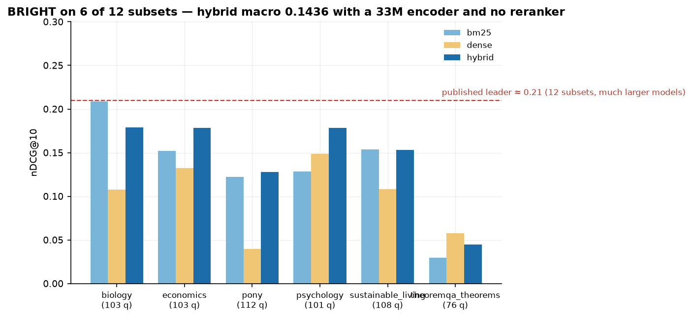
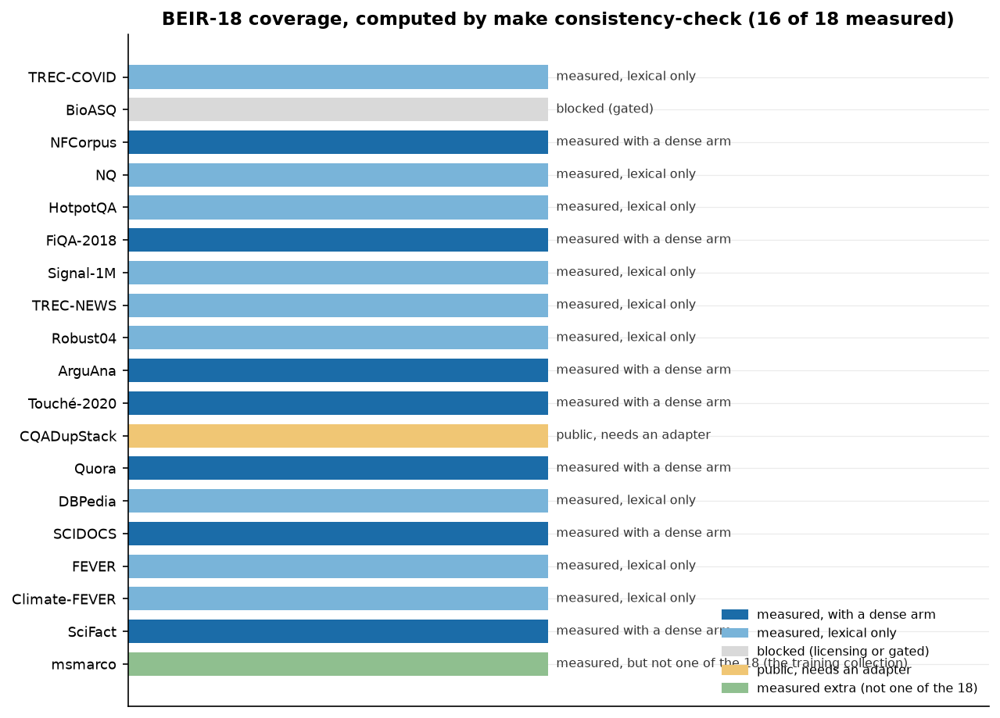
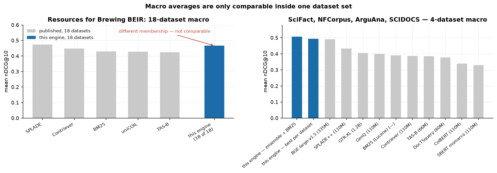
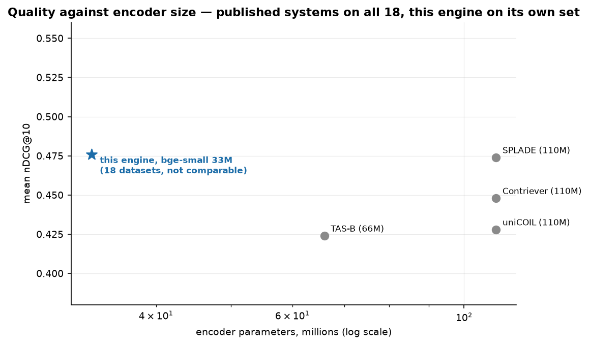
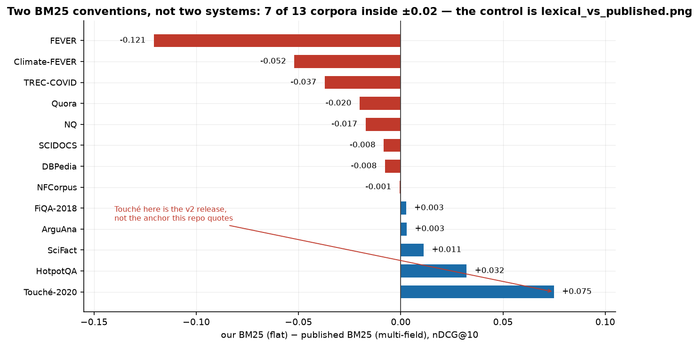
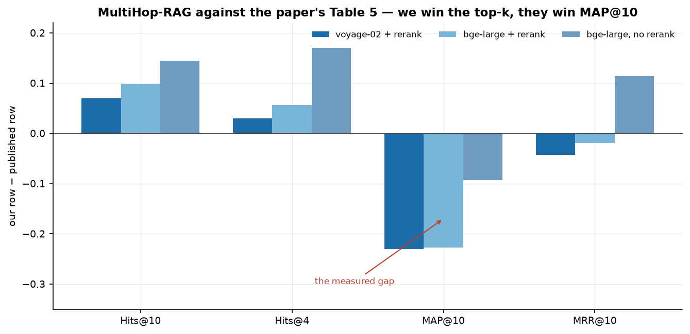
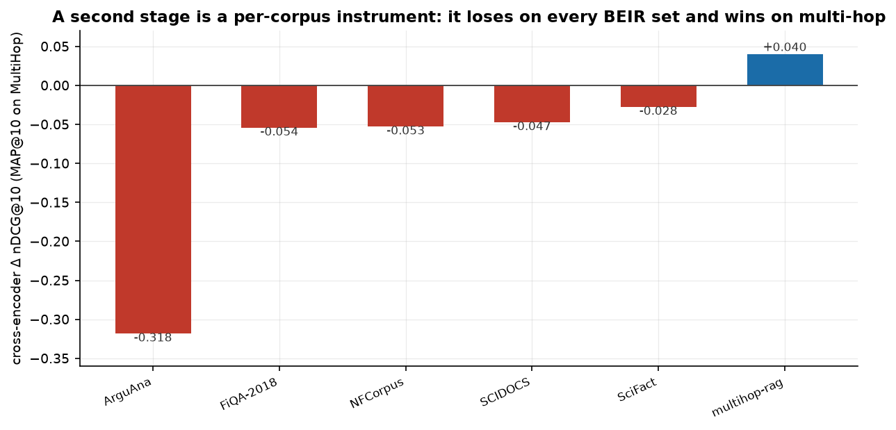
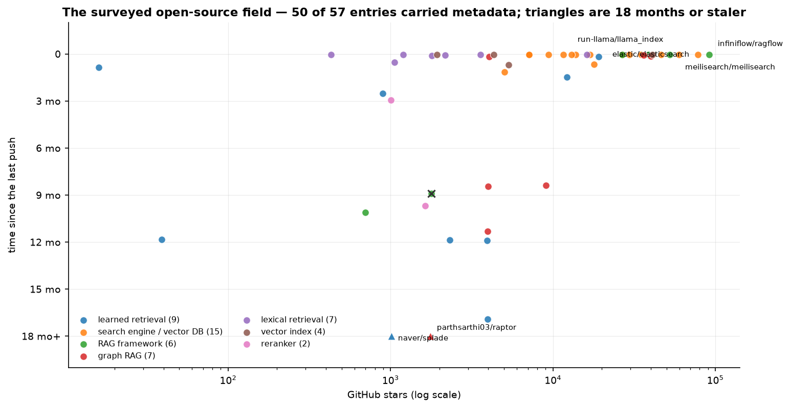
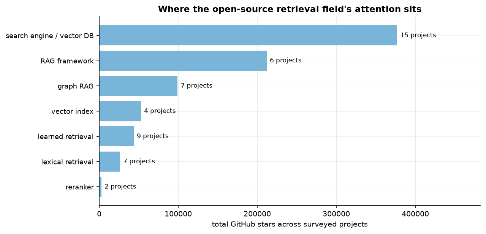

# How this engine compares to other RAG and retrieval systems

Everything on this page is a comparison *across systems* — this engine against published retrieval
models, and the engine against the shape of the open-source field it lives in. Every figure is
generated by `make charts-compare` (`tools/charts_compare.py`) from three inputs, none of which is a
hand-typed number:

| input | what it is | where |
| --- | --- | --- |
| this repository's reports | per-dataset nDCG@10, the MultiHop-RAG protocol, the cross-encoder arms | `eval/**/*.json`, read through the registries in `tools/consistency_check.py` |
| the published BEIR-18 table | five systems × 18 datasets, nDCG@10 and Recall@100 | `tools/published_beir18.py`, **parsed** from the paper's HTML |
| the open-source survey | 57 repositories with stars, language, last push, archived | `../.research/repo-metadata.json` |

Three rules the figures follow, because the surrounding documents are held to them:

1. **Membership is stated.** A macro average is drawn with the dataset set it is over. Anything of
   ours measured on a different set is annotated as not comparable rather than placed on the same
   axis quietly.
2. **A missing report is a gap, not a zero.** Datasets we have not run appear as dashes, not as
   0.0, and a system with no published number is absent rather than inferred.
3. **No number is typed into a chart.** `tools/charts_compare.py --check` pins the published table's
   own arithmetic (the paper's average must be the mean of its own 18 rows) and the membership rule
   (a corpus outside the 18, like MS MARCO, cannot enter an "of 18" average).

---

## 1. BEIR-18: six systems on one grid


This is the whole comparison in one picture. Rows are this engine's best measured row per dataset
plus the five systems the paper tabulates; columns are the 18 datasets in the benchmark's own
order. Dashes are datasets we have not run — the membership is visible in the figure rather than
implied by it.

**Where we lead.** Of the 13 datasets we have run, we are ahead of *the best of the five published
systems* on **7**: ArguAna (+0.135), FiQA (+0.093), Touché (+0.075), SciFact (+0.068), SCIDOCS
(+0.060), NFCorpus (+0.042), Quora (+0.023).

**Where they lead.** Six, and the losses are concentrated:

| dataset | ours | best published | gap |
| --- | --- | --- | --- |
| NQ | 0.312 | SPLADE 0.544 | **−0.232** |
| FEVER | 0.632 | uniCOIL 0.812 | **−0.180** |
| DBPedia | 0.305 | SPLADE 0.442 | **−0.137** |
| TREC-COVID | 0.619 | SPLADE 0.711 | −0.092 |
| Climate-FEVER | 0.161 | TAS-B 0.237 | −0.076 |
| HotpotQA | 0.635 | SPLADE 0.686 | −0.051 |

The pattern in the losses is not size — DBPedia at 4.6M is our smallest loss among the big ones
and NFCorpus at 3.6k is a win. It is that the three largest losses (NQ, FEVER, DBPedia) are
**lexical-only runs**: those corpora were measured with the shipped BM25 path and no dense arm,
because the multi-million-document embedding pass was not run. The comparison is therefore as much
a statement about what we spent compute on as about the system.

## 2. BRIGHT — reasoning-intensive retrieval, against its published leader



BRIGHT is the benchmark where dense-only retrieval is *supposed* to be weak and BM25 competitive,
and it is the one place a published leader number is quoted here: **≈0.21 nDCG@10 macro**, from
models vastly larger than this engine's. On the six subsets the repository has run, the hybrid
macro is **0.1436** — a −0.066 gap, and the repository quotes it as explicitly not comparable (6 of
12 subsets, a 33M encoder, no reranker). The per-subset detail is the interesting part: BM25 beats
dense on `biology` (−0.101) and `pony` (−0.082), dense beats BM25 on `theoremqa_theorems` (+0.028),
and the hybrid is the best arm on four of the six.

---

## 3. What of the benchmark is measured, and why the rest is not



Membership and blockers, taken from `make consistency-check` rather than typed: **13 of 18**
measured (seven with a dense arm, six lexical-only), four blocked on licensing or gating, one
(CQADupStack) public but needing a per-forum adapter, and one measured corpus — MS MARCO — that is
*not one of the 18* at all. That last row is the reason the count is computed over an explicit
member set: before it, the prose had nineteen candidates for an eighteen-dataset denominator.

---

## 4. Macro averages are only comparable inside one dataset set



Two panels, two memberships, and they are not interchangeable:

- **Left.** The paper's 18-dataset macro for its five systems — SPLADE **0.474**, Contriever
  **0.448**, BM25 **0.429**, uniCOIL **0.428**, TAS-B **0.424** — beside this engine's macro over
  the **13 datasets it has run: 0.4979**. The engine bar is drawn in the engine's colour and
  annotated *different membership — not comparable*; it is a statement about our 13, not about
  BEIR-18.
- **Right.** The comparison that *is* like-for-like: the four datasets everybody has —
  SciFact, NFCorpus, ArguAna, SCIDOCS. There this engine reads **0.495** (best per dataset,
  computed 0.4947) and **0.507** (single 3-model ensemble fused with BM25, computed 0.5072) against
  BGE-large-v1.5's 0.491 at 335M parameters. This is the same table `RANKINGS.md` and the README
  carry, drawn rather than transcribed.



The same numbers against encoder size. The published dense models sit at 66M–1.2B parameters;
this engine's shipped encoder is **33M** (`bge-small`), and its quality point is drawn on its own
13-dataset mean, explicitly not comparable to the published 18-dataset axis. The honest reading is
not "better per parameter" — it is that a 33M encoder plus lexical fusion lands in the same band as
110M–335M models on the four datasets both sides have run.

---

## 5. The lexical control, and a convention trap


This is the repository's lexical control: our `bm25-engine` against the flat Pyserini BM25 anchors
pinned in `tools/compare.py`. It is the like-for-like BM25 comparison, and it is the one the
claim ledger pins.



This second figure is deliberately **not** that control. It compares our flat BM25 against the
paper's **multi-field** BM25 — the same scoring function indexing title and body as separate
fields — and one of its rows (Touché-2020) is a different collection release (v2). Seven of the 13
corpora sit inside ±0.02 and six do not, which is a statement about *convention and release*, not
about the retriever: SciFact moves from +0.011 against the multi-field column to −0.003 against the
flat anchor, and Touché swings 0.075 for the same reason. It is on the page because a reader who
sees one BM25 number next to another deserves to see how much of the gap is the index.

---

## 6. Multi-hop: where the published systems still win



Our row minus each of the paper's three published rows, per metric. On the benchmark's own
protocol (2,255 queries, 4,592 chunks, hybrid first stage) we **win the top-k** and **lose MAP@10**:

| metric | vs `voyage-02` + rerank | vs `bge-large` + rerank | vs `bge-large`, no rerank |
| --- | --- | --- | --- |
| Hits@10 | +0.055 | +0.084 | +0.130 |
| Hits@4 | +0.024 | +0.050 | +0.163 |
| **MAP@10** | **−0.230** | **−0.225** | **−0.091** |
| MRR@10 | −0.046 | −0.025 | +0.108 |

The chart uses the **hybrid first stage**, not the coverage-plus-quota row the README also
carries (that row reads 0.896 / 0.759 / 0.319 / 0.619 and narrows the MAP@10 gap to −0.157 against
the published best). The absolute figures are in the README's MultiHop chart; the delta view is
here because it makes
the shape obvious: retrieval finds the evidence, selection spends it badly, and the multi-hop MAP
gap the programme has chased since Phase 2 is visible as the red block.


---

## 7. A second stage is a per-corpus instrument



The cross-encoder — the technique most RAG stacks reach for by default — measured on six corpora
with the same pool and the same protocol. It **loses on every BEIR dataset** (ArguAna catastrophically,
−0.318) and **wins on multi-hop** (+0.040 MAP@10). A system that ships one global second-stage
configuration is therefore wrong on one of these two families by construction; this engine routes
it per corpus instead.


The same reversal runs through the first stage: dense wins on eight corpora, lexical wins on Touché
by two to one, and FRAMES — long Wikipedia text like Touché — lands on the other side. The axis is
the query against the document, not length or domain.

---

## 8. The open-source field this engine lives in



Fifty of the 57 surveyed repositories carried usable metadata (seven fetches failed and are
dropped rather than charted at zero). Size against recency, coloured by a curated category: most of
the field is fresh, the vector-database and search-engine band is the most crowded, and exactly
**two** projects are staler than 18 months — the SPLADE reference implementation (886 days) and a
RAPTOR implementation (764) — both research code that stopped rather than products that did.



| category | projects | total stars (GitHub, at the survey's date) |
| --- | --- | --- |
| search engine / vector DB | 15 | 376,871 |
| RAG framework | 6 | 211,798 |
| graph RAG | 7 | 99,055 |
| vector index | 4 | 52,700 |
| learned retrieval | 9 | 43,549 |
| lexical retrieval | 7 | 26,411 |
| reranker | 2 | 2,647 |

Stars are a point-in-time snapshot from `repo-metadata.json` (refreshed 2026-10-07), and they
measure attention, not quality — the category with the most stars is the one furthest from the
retrieval question this engine answers.

**Where this engine sits, honestly: nowhere on that chart.** It is not a framework, not a vector
database, not a hosted service — it is a single-process CPU engine with a claim ledger. The
comparison that matters for it is not stars but the one in sections 1–6: measured retrieval quality
against published models, with the membership and the intervals stated. What the landscape shows is
that the *components* it composes (lexical retrieval, ANN indexes, rerankers, embedding models) are
a crowded, actively maintained field, which is why it composes them instead of rebuilding them.

---

## 9. What is deliberately not on this page

- **The MTEB leaderboard.** Its retrieval subset overlaps BEIR but the aggregate is over a
  different dataset set, and this engine has no submission. A row there would be a comparison
  across memberships — the thing section 4 exists to prevent.
- **BEIR-13 against BEIR-18 aggregates.** Never mixed. Every macro on this page names its set.
- **MS MARCO as a BEIR row.** It is measured (8,841,823 documents, lexical nDCG@10 0.4321) and it is
  the collection BEIR's encoders are trained on, not a test dataset; it is charted only as an extra.
- **The 40,000-document TREC-COVID subsample.** Superseded by the full 171,332-document run, and
  quarantined by the consistency gate so it cannot be read as a result.
- **Trust, robustness and calibration against other systems.** This engine has measured poison
  leakage, negative rejection, injection flags, tenant isolation, verifier precision and
  answerability calibration; the published systems have not reported comparable numbers, so a chart
  would be one bar and four blanks. The engine's own trust figures are in
  [findings-trust.md](findings-trust.md) and the reliability diagram below.
- **Generation quality.** Every end-to-end metric here needs a generator and usually a judge, so
  the number belongs to the model, not the engine.


---

## Reproduction

```sh
make charts-compare        # the nine comparison figures on this page
make charts                # every figure in the repository, including the ones above
.venv/bin/python tools/charts_compare.py --check    # offline invariants, no reports needed
.venv/bin/python -m pytest tests/test_charts_compare.py -q
```

The published table is re-derived from the source page by
`curl -sL https://arxiv.org/html/2306.07471 -o eval/.cache/brewing-beir.html` and parsing Table 2;
`tools/published_beir18.py` carries the parsed values with the conventions and the v2 caveat
written into its docstring. The open-source survey is regenerated by `.research/repo-metadata.sh`.
